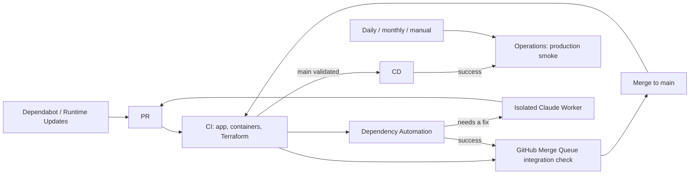

# Workflow map

The everyday entry points are **CI, CD, Dependency Automation, and Operations**.
PR validation runs in one CI run, and monitoring is collected in one Operations view.



## Entry points and components

| Entry point | Role |
| --- | --- |
| `ci.yml` | Validates PRs, Merge Queue, and main. Detects changes once and aggregates the four required checks |
| `cd.yml` | Builds validated main and deploys to production with separated write permissions |
| `dependency-queue.yml` | Verifies an update PR's origin, then sends it to the standard queue after CI success, or to Claude if it needs a fix |
| `operations.yml` | Six recurring monitors plus on-prem and inference validation, post-CD smoke, and manual selection |
| `runtime-updates.yml` | Creates daily runtime update PRs |
| `claude-dependency-worker.yml` | Runs permitted repairs; verifies and applies them on a separate runner |
| `codeql.yml` | GitHub code analysis |
| `terraform-apply.yml` | Production Terraform apply and approval |
| `cloudflare-resources.yml` | Cloudflare resource sync |
| `onprem-release.yml` | Signed public container and chart releases |
| `seo-monitor.yml` | Read-only daily audit of public pages; see [search engine visibility](../docs/operations/seo.md) |
| `api-aws-key-rotation.yml` | Weekly read-only key-age audit and staged rotation of the production API AWS key; see [the runbook](../docs/operations/api-aws-key-rotation.md) |
| `openrouter-identity.yml` | Manual inspection and setup of OpenRouter workload identity; see [cloud AI](../docs/operations/openai-transcription.md) |
| `ai-credential-audit.yml` | Manual inventory of remaining hosted AI credential copies, without printing values |
| `retire-ai-credentials.yml` | Manual plan and guarded retirement of reviewed direct AI keys |
| `public-demo-setup.yml` | Manual audit and provisioning of the `/try` sample course; see [public demo](../docs/operations/public-demo.md) |

`container-validation.yml`, `terraform-plan.yml`, `onprem-validation.yml`, and
`local-inference-basic.yml` are validation components called from CI and Operations.
They have no event triggers of their own. Keep per-job permissions, environments, and
approvals rather than mixing differently privileged work on one runner.

The Package Namespace Bootstrap and Retired Package Cleanup workflows, CLIs, and tests
needed only for the repository transfer were removed; see Git history if needed.
Published packages, past signatures, and releases are not deleted.

Also removed: the one-time Django ETL, cutover, and table-removal tools with their npm
entry points, generators used only for already-applied SQL, the old landing-video
generator, and an unused Whisper API proof of concept. Applied SQL and served videos
stay. Current database updates use `apps/api/scripts/db-migrate.sh`, and videos are
generated with `apps/demo-video`. Generation commands inside old SQL remain as records.

Dependency merge ordering now uses only GitHub Merge Queue. The old queue's REBASE
branch, manual follow-up inputs from the transfer, and the daily stale-PR report were
retired. Automatic follow-up after a real integration CI failure and Claude repair
start from events.

## Run a check manually

```sh
# Run a single monitor
gh workflow run operations.yml -f check=tokens
# Simulate token expiry (does not cause a real notification failure)
gh workflow run operations.yml -f check=tokens -f dry_run=true -f preview_date=2026-12-10
# All monitors, including production smoke and the database restore test
gh workflow run operations.yml -f check=all
```

Operations runs daily at 09:17 JST, inference compatibility every Monday at 11:17 JST,
and the database restore on the 1st of each month at 13:41 JST.
`check=onprem` can add validation with explicit `validate_real_cpu` and `validate_whisper_gpu`.
In CI's on-prem validation, vulnerability scans of pinned upstream images (llama.cpp and
whisper.cpp) are limited to PRs that change those pins or scan settings, and to manual CI.
Daily Operations always scans them.
Monitors do not open Issues; results go to the job summary.
See [dependency-automation.md](dependency-automation.md) for update processing and
[OPERATIONS.md](OPERATIONS.md) for what the monitors do.
