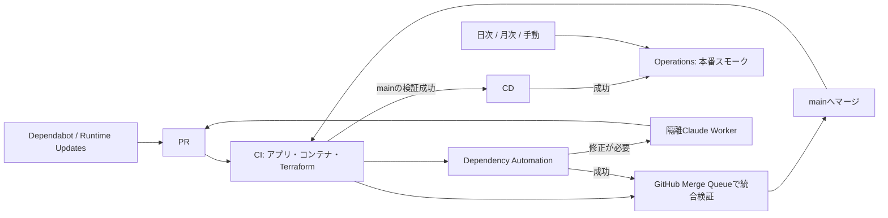

# ワークフローの見取り図

普段見る入口は **CI・CD・Dependency Automation・Operations**。
PRの検証はCIの1実行にまとまり、監視はOperationsの1画面にまとまる。



## 入口と部品

| 入口 | 役割 |
| --- | --- |
| `ci.yml` | PR・Merge Queue・mainの検証。変更検出は1回。4つの必須チェックをここに集約 |
| `cd.yml` | 検証済みmainをビルドし、書き込み権限を分離して本番へデプロイ |
| `dependency-queue.yml` | 更新PRの由来を確認し、CI成功なら標準キューへ、修正が必要ならClaudeへ |
| `operations.yml` | 定期監視6種類とオンプレミス・推論検証、CD成功後のスモーク、手動の項目選択 |
| `runtime-updates.yml` | 日次のランタイム更新PR作成 |
| `claude-dependency-worker.yml` | 許可された修正の実行。別runnerで検証・反映 |
| `codeql.yml` | GitHubのコード解析 |
| `terraform-apply.yml` | Terraformの本番適用と承認 |
| `cloudflare-resources.yml` | Cloudflareリソース同期 |
| `onprem-release.yml` | 公開コンテナ・チャートの署名付きリリース |

`container-validation.yml`・`terraform-plan.yml`・`onprem-validation.yml`・
`local-inference-basic.yml` はCI・Operationsから呼ぶ検証部品で、独自のイベント起動は持たない。
権限の違う処理を一つのrunnerに混ぜず、ジョブごとの権限・環境・承認を維持する。

移管時だけ必要だったPackage Namespace BootstrapとRetired Package Cleanupの
ワークフロー・CLI・専用テストは削除した。必要ならGit履歴を参照する。
公開パッケージ・過去の署名・リリースは削除しない。

旧Djangoからの一度限りのETL・切り替え・テーブル削除ツールとnpmの入口、
適用済みSQLの生成専用ツール、旧LP動画ジェネレーター、未使用のWhisper API PoCも削除した。
適用済みSQLと配信中の動画は維持する。現行のDB更新は `apps/api/scripts/db-migrate.sh`、
動画生成は `apps/demo-video` を使う。過去のSQL内にある生成コマンドは当時の記録として残す。

依存更新の順番管理はGitHub Merge Queueに統一した。旧キュー用のREBASE分岐と
移管時の手動追従入力、日次のPR滞留レポートは廃止した。
実際の統合CI失敗時の自動追従とClaude修正はイベントで起動する。

## 手動で確認する

```sh
# 一つの監視だけを実行する
 gh workflow run operations.yml -f check=tokens
# トークン期限をシミュレーションする（本物の通知失敗にはしない）
 gh workflow run operations.yml -f check=tokens -f dry_run=true -f preview_date=2026-12-10
# 全監視（本番スモークとDB復元テストも含む）
 gh workflow run operations.yml -f check=all
```

Operationsの日次実行は09:17 JST、推論互換性は毎週月曜11:17 JST、DB復元は毎月1日13:41 JST。
`check=onprem` では `validate_real_cpu`・`validate_whisper_gpu` を明示して追加検証できる。
監視はIssueを起票せず、結果をジョブのサマリーへ記録する。
更新処理の詳細は [dependency-automation.md](dependency-automation.md)、
監視の内容は [OPERATIONS.md](OPERATIONS.md) を参照。
