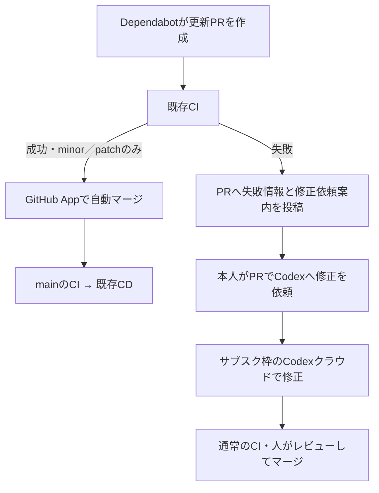

# 依存関係の自動更新・修正

## 最新mainへの自動追従

自動マージ予約済みのDependabot PRが `BEHIND` になった場合、**Dependency Main Sync** が
GitHubのrebase APIで最新mainへ追従する。mainへのpush・CI完了イベントで候補を再確認し、
1回につき古いPRから1件を処理する。最新SHAのCIが成功したPRのみ対象。定期実行はしない。
必要な場合はActionsの **Dependency Main Sync** をmainから手動実行できる。
失敗したPRの完了イベントでも他の候補を進めるが、追従するのはCI成功済みのPRだけ。

GitHubのAPIによるrebaseは元のコミット署名を引き継がないため、信頼済みBotが追従記録を
残し、元の署名済みDependabotコミット・更新種別・変更行が同一であることを毎回APIで再検証する。
人が追記したコミットや、記録と対応しない変更は認めない。Claude修正がある場合も既存の反映記録と
変更範囲を照合する。追従後のCIが失敗すれば既存のClaude修正判定へ進み、成功すればマージする。
Terraformの本番自動適用にも同じ追従記録の検証を使う。

ブランチ保護のstrict条件は維持する。CIの省略や保護のバイパスはしない。差分を取得できない場合や
追従に失敗した場合は自動マージを止めてPRへ通知する。同じhead/mainの組への要求は30分間隔、最大3回。
停止は `DEPENDENCY_REBASE_ENABLED=false`、PR単位では `no-rebase` または `no-automerge`。
初期状態では、既存の `DEPENDENCY_AUTOMERGE_ENABLED=true` とApp設定があれば有効。

## Claudeによる自動修正から自動マージまで

`CLAUDE_DEPENDENCY_REPAIR_ENABLED=true` の場合、npm／Pythonのminor・patch更新で
CIが失敗すると、Claude Codeがサブスク認証で互換性修正を実行する。本人のコメントや
PCの常時起動は不要。成功した更新は従来の自動マージ経路を使う。

```text
Dependabot → CI成功 → 既存の自動マージ
           → CI失敗 → Claudeで修正 → パッチ検証・GitHub Appで反映
                                   → 通常CI成功 → 自動マージ
                                   → 再失敗 → 2回目の修正／人へ通知
```

### 初回設定

1. Claudeの対象サブスクで `claude setup-token` を実行し、発行された値をActions Secret
   `CLAUDE_CODE_OAUTH_TOKEN` に保存する。値をPR、ログ、チャットへ貼らない。
2. この変更をmainへ反映する。既存の `PATCH_BOT_APP_ID` と `PATCH_BOT_PRIVATE_KEY`、
   `DEPENDENCY_AUTOMERGE_ENABLED=true`、strictなmain保護を利用する。
3. **Claude Dependency Repair** をmainから `authentication_test=true` で実行し、サブスク認証を確認する。
   この実行ではツールやPRの変更を許可しない。
4. Actions Variable `CLAUDE_DEPENDENCY_REPAIR_ENABLED` を `true` にする。
5. 新しいDependabot PRで動作を確認する。既存の依存ファイルのみのPRは
   **Dependency Auto-merge** を再実行して検証済み更新情報を記録し、そのPRの最新CI run IDで
   **Claude Dependency Repair** をmainから手動実行できる。

トークンは通常のClaude利用と枠を共有する。利用上限・認証エラーで停止した場合はPRへ
通知する。GitHub Actionsの実行時間・料金も別途発生し得る。

### 判定と権限

- 対象は同一リポジトリのmain向けDependabot PR。公式metadataによるminor／patch判定と、
  元の全コミットのDependabot署名検証を既存ワークフローで行い、信頼済みBotコメントへ記録する。
- mainの信頼済みスクリプトが、CI workflow ID、現在のhead、最新run／attempt、元の依存差分、
  修正コミットの親子関係と反映記録をAPIで再検証する。人の追記・major・forkは対象外。
- 修正はPR全体で最大2回。同じSHAは再実行しない。失敗・無変更も1回として数える。
- Claudeには読み取り専用のGitHub tokenだけを渡す。別runnerの信頼済みジョブがパッチを
  新しいcheckoutへ適用し、既存のソースファイルのみ・8ファイル以下・300変更行以下を検証する。
  npm／Pythonの依存ファイル、テスト、設定、認証、資格情報、migration、CI、配備の変更は拒否する。
  実行部分は独立した `claude-dependency-worker.yml` へdispatchし、入力されたSHA・CI・PRと
  main上の実際の判定runを再検証する。実行許可の使用を記録し、同じ許可による重複起動を拒否する。
- パッチ反映にはGitHub Appを使い、通常のPR CIを再実行する。Claude自身にはpush・マージを任せない。
  最終マージは最新SHAとstrictなブランチ保護を確認して予約し、GitHubの必須検査をすべて待つ。
- Supply Chain Security／Deployment Security Testsが成功していない場合はClaudeを起動せず通知する。
  検査結果の例外追加・無効化はしない。ソース差分の内容が安全だと機械的に証明するものではない。
- `no-claude`、`no-codex`、`no-automerge` は自動修正を止める。以前の手動Codex修正依頼が残るPRは
  引き続き人が確認する。自動修正の有効時は旧Codex案内ワークフローを停止し、二重処理を防ぐ。

停止は `CLAUDE_DEPENDENCY_REPAIR_ENABLED=false`。既に始まった実行はActionsからcancelする。
予約済みのマージは別途 `gh pr merge PR番号 --disable-auto` で解除する。
人による変更が必要になったPRは自動処理を止めて通常のレビューを行う。

検証: `node --test .github/scripts/*.test.cjs` と
`actionlint .github/workflows/claude-dependency-*.yml .github/workflows/dependency-automerge.yml .github/workflows/codex-dependency-repair.yml`。

参考: [Claude Code GitHub Actions](https://code.claude.com/docs/en/github-actions)、
[公式Action設定](https://github.com/anthropics/claude-code-action/blob/main/docs/setup.md)。

## 従来のCodexによる手動修正依頼（Claude自動修正が無効な場合）

minor／patch更新はGitHubで自動マージし、CIが失敗した場合はGitHub連携のCodexへ修正を依頼する。
修正にはChatGPTログインのCodex利用枠を使う。OpenAI APIキーの登録、認証ファイルの転送、
PCの常時起動、ローカルの定期タスクは不要。

**自動化するのはminor／patch更新のマージと修正依頼の案内まで。Codexによる修正の開始には、
GitHub連携を設定した本人がPRにコメントを投稿する。** Botのコメントが本人のサブスク枠で
Codexを自動起動できるとは仮定しない。



## CodexのGitHub連携を設定する

1. サブスク契約のChatGPTアカウントでログインする。
2. [CodexのGitHub連携設定](https://chatgpt.com/settings/code-review)から
   `yukiharada1228/videoq` を接続し、リポジトリへのアクセスを許可する。
   この設定はGitHub Appのpatch自動マージ設定とは別。
3. クラウド環境にこのリポジトリを設定する。Node 22、Python 3.12、npm workspacesを使用し、
   必要なテストに応じてffmpeg・Chromium・使い捨てPostgresを準備する。
4. CI失敗時の案内が出たら、本人のGitHubアカウントからPRコメントに次を投稿する。

```text
@codex fix the CI failures. Read .github/codex/repair-dependencies.md, preserve the dependency update and security fixes, make the smallest fix, rerun the affected checks, and report the results. Do not merge the PR.
```

案内コメントには実際の失敗run・attempt・コミットSHAを含めた依頼文を用意する。
Codexが反応したら、GitHub連携から起動したクラウドタスクで修正を確認する。
ブランチへの書き込み権限がない場合は、修正PRまたはpatchとして受け取る。

利用可能な機能と残りの利用枠は契約プラン・ワークスペース設定に従う。
自動レビューも設定できるが、それだけでCI修正が自動開始するわけではない。
GitHub連携は現時点の公式ドキュメントではCodex Cloud (Legacy)の環境を使用する。

## CI失敗時の案内

`.github/workflows/codex-dependency-repair.yml` は `CI` の失敗後に動く。
mainの信頼済みスクリプトだけを読み込み、PRのコードやモデルは実行しない。

- ワークフローID、リポジトリ、PRの現在のhead、最新CI run/attemptをAPIで照合する。
- 対象はnpm/Pythonの依存関係ファイルだけを変更するDependabot PR。minor/major更新の失敗も対象。
- fork PR、通常の開発PR、古いSHA、解決済みのCI、閉じたPR、`no-codex` ラベル付きPRは除外する。
- PRごとに案内コメントを1つ保持する。同じ失敗の再実行では重複投稿せず、新しい失敗では更新する。
- 案内前に自動マージ予約を解除する。信頼済みBotの案内コメントが残るPRは以降も自動マージ対象外。
  修正の確認後は手動でマージする。
- Botの案内にはCodexを起動するメンションを含めず、本人が投稿する方法を示す。

このワークフローはmainへ反映すると有効になり、標準の `GITHUB_TOKEN` だけを使う。
追加のGitHub AppやOpenAIのSecretは不要。停止する場合はActions Variable
`CODEX_REPAIR_REQUESTS_ENABLED` を `false` にする。

手動で案内を再評価する場合はActions → **Codex Dependency Repair Request** →
Run workflowでbranchを `main` にし、`run_id` に失敗したCI runの数値IDを指定する。
この操作もCodex本体を実行するものではない。

## minor／patch更新の自動マージ

自動マージは初期状態では無効。対象条件は以下。

- 同一リポジトリ内のDependabot作成・`dependabot/` ブランチ・main向けPR。
- npm・Python・Docker・Docker Compose・Terraform・GitHub Actionsのminor／patch更新。グループにmajorが混ざれば対象外。
- 更新種別に対応する既存の依存ファイルだけを変更し、最大50ファイル。Terraformはproviderのversion制約とlockfile、GitHub Actionsは同じActionの完全SHA参照の更新だけを許可する。
- Dependabot公式Actionの更新種別確認を通過し、maintainer変更表示がない。全PRコミットが署名検証済みDependabotコミットで、手動追記やmainの手動マージを含まない。
- `no-automerge` ラベルも、信頼済みBotのCodex修正依頼案内もない。
- mainの必須チェックがGitHub Actionsの `CI Success` で、strict（最新mainへの追従必須）が有効。

`gh pr merge --auto --squash --match-head-commit` で予約し、GitHubが必須チェックと
ブランチ保護を満たした時点でマージする。最新mainを取り込めていなければ待機する。
major更新、配備ツール（`.github/deploy-tools`）、submodule、ソース変更、Codex修正はレビュー対象。
Docker／Composeは `Container Validation`、Terraformは `Terraform Plan` の成功も必要。DockerfileとCompose設定、provider更新の検証とmockテストを本番資格情報なしで実行する。

有効化手順：

1. この変更をmainへマージする。
2. リポジトリ専用GitHub Appを作成・インストールする。Webhookは不要。
   Repository permissions: **Contents: Read and write**、**Pull requests: Read and write**、
   **Administration: Read-only**（ブランチ保護の確認用）、**Workflows: Read and write**（GitHub Actions更新のマージ用）、標準のMetadata Read-only。
   mainの保護をバイパスする権限は付けない。
3. [Actions secrets / variables](https://github.com/yukiharada1228/videoq/settings/secrets/actions)に以下を登録する。

| 種類 | 名前 | 値 |
| --- | --- | --- |
| Variable | `PATCH_BOT_APP_ID` | GitHub AppのApp ID |
| Secret | `PATCH_BOT_PRIVATE_KEY` | GitHub Appから生成したPEM秘密鍵 |
| Variable | `DEPENDENCY_AUTOMERGE_ENABLED` | 有効化時に `true` |

4. [General settings](https://github.com/yukiharada1228/videoq/settings)で **Allow auto-merge** と squash mergeを有効にする。
5. mainの既存ブランチ保護（`CI Success` 必須・strict）を維持する。
6. 既存PRはラベル変更または対象ワークフローの再実行で再評価する。

GitHub Appはマージ後に通常のmain push CI・CDを起動するために使う。
Codexのサブスク認証には使わず、Codexの修正依頼案内にも不要。

## 停止と移行

- `no-automerge` ラベルでPRの自動マージ予約を解除する。`no-codex` は修正依頼の案内を止める。
- 全体の自動マージを止める場合は `DEPENDENCY_AUTOMERGE_ENABLED=false` とし、予約済み分も
  `gh pr merge PR番号 --disable-auto` で解除する。
- 以前のAPI版の `OPENAI_API_KEY`、`CODEX_AUTOFIX_ENABLED`、`CODEX_AUTOFIX_MODEL` は、この仕組みでは使わない。
  ほかの用途で使っているSecretまで削除する必要はない。
- ローカルのログイン情報や `auth.json` をGitHubへ登録しない。

## 検証

```sh
node --test .github/scripts/*.test.cjs
actionlint .github/workflows/dependency-automerge.yml .github/workflows/codex-dependency-repair.yml
```

ローカルでは対象判定、重複防止、古いrun拒否、自動マージ解除、API実行が含まれないことを検証する。
GitHubへの実反映・Codex連携は別途設定後に確認する。

参考： [Codexの認証と利用枠](https://developers.openai.com/codex/auth)、
[Codex GitHub連携と修正依頼](https://developers.openai.com/codex/integrations/github)、
[GitHubのDependabot自動化](https://docs.github.com/en/code-security/tutorials/secure-your-dependencies/automate-dependabot-with-actions)。


## サプライチェーン対策

`CI Success` と `Supply Chain Security` の両方を GitHub Actions の必須チェックにします。検査の失敗・タイムアウト時はマージしません。

- Dependency Review と OSV で、この変更が導入する既知の脆弱性を検査します。既存の未修正問題まで解消済みと判定する検査ではありません。
- lockfile の配布元を npm / PyPI の公式レジストリに限定し、整合性ハッシュと同一バージョンの改変を確認します。新しい npm バージョンには SHA-512 を要求します。
- `npm ci --ignore-scripts` の後に `npm audit signatures` で署名・提供されている provenance を検証します。署名は配布元と完全性を確認するもので、パッケージに悪意がないことの証明ではありません。
- 新しくインストールスクリプトを持つパッケージを追加する場合は `.github/supply-chain-policy.json` のレビューが必要です。このポリシー変更は自動マージ対象になりません。掲載済みパッケージのインストールスクリプトも実行しません。
- 通常の npm / uv 更新は公開後 7 日の cooldown を設けます。Dependabot のセキュリティ更新は cooldown の対象外です。修正リリースと GitHub の脆弱性情報が利用可能になった後に PR が作られ、必須検査が成功したminor／patch更新のみ自動マージされます。公開直後の適用時刻は保証しません。
- Action は完全なコミット SHA に固定し、checkout の資格情報を残しません。依存コードの実行に書き込み権限や本番資格情報を渡さない構成を維持します。

未知の悪意ある更新・正規アカウントの乗っ取り・実行時の不正動作を完全に検出できるものではありません。疑わしい PR には `no-automerge` を付け、`DEPENDENCY_AUTOMERGE_ENABLED=false` で全体を止めてください。すでに予約済みの auto-merge は別途解除してください。

セキュリティ検査が失敗したときは、Codex に検査の無効化・署名検証のスキップ・無条件の例外追加を依頼しません。原因と公開された修正を確認し、ポリシーの変更は人がレビューします。API キーは不要で、既存の ChatGPT サブスクによる修正依頼方式は変わりません。

参考: [GitHub Dependency Review](https://github.com/actions/dependency-review-action)、[npm の署名検証](https://docs.npmjs.com/verifying-registry-signatures/)、[Dependabot cooldown](https://docs.github.com/en/code-security/reference/supply-chain-security/dependabot-options-reference#cooldown)。


### videoq のビルド・配備の分離

Cloudflare 用のアプリ依存は資格情報のない `application-build`、Lambda イメージは AWS 権限のない `worker-build` でビルドします。同一 CD 実行内の SHA 付き成果物だけを別ジョブへ渡し、Cloudflare は `--no-bundle`、AWS はイメージを実行せず push する方式です。アップロード設定は成果物から読み込まず、検証済み main の設定から許可した項目だけを生成します。

Wrangler、DB マイグレーション の依存は `.github/deploy-tools` に独立してロックします。アプリ依存のパッチ更新でこのツール群は変わりません。このディレクトリの更新は手動レビュー対象です。DB マイグレーション 自体は、その用途に必要な資格情報へアクセスする信頼対象として残ります。配備されたアプリの実行時の不正動作を防ぐ保証ではありません。

Python worker は CI と Docker ビルドの両方で `uv.lock` から依存を固定し、`--require-hashes --only-binary=:all:` で配布物を検証します。ソース配布からの任意ビルドを許可しません。通常の Python 更新も7日間待機し、セキュリティ更新は例外です。

### 現在把握している残存リスク（2026-10-22）


既存のドキュメント・開発ツール依存に `braces <=3.0.3` の [GHSA-vfj7-8cjw-p6xm](https://github.com/advisories/GHSA-vfj7-8cjw-p6xm) が含まれます。深くネストしたパターンによる DoS で、現在の npm 情報には互換性を保った修正版がありません。`npm audit fix --force` が提案する大幅なダウングレードは適用しません。ビルドを資格情報のないジョブに隔離し、時間制限を付けた上で、Dependabot の通知と修正版を監視します。今回の変更は既存問題を解消済みとは扱いません。

## オンプレ配布の検証

オンプレ用の API・Web・ワーカーのビルド、HTTP 検証、Trivy 検査を CI の
`CI Success` に接続します。HIGH/CRITICAL は修正版未提供でも検査を失敗させます。
CycloneDX の構成部品一覧を30日間保存し、PR のビルドには本番資格情報を渡しません。
Helm は `requireImageDigests=true` で全イメージの digest 指定を必須にできます。

依存 PR のマージからオンプレ本番への適用には、導入先のイメージ配布・検証・GitOps 等の
経路が必要です。`On-prem Release` は CI 成功後に GHCR へ署名付きイメージを配布し、
署名検証後に使い捨て Kubernetes で更新・復元を検証します。`On-prem Validation` は毎日も実行します。
本番サイトへの接続先は未定のため、本番への反映は運用担当者の承認と設定を必要とします。
CI 修正は上記のClaude自動修正、または無効時の本人によるCodex依頼方式を使います。
導入時の署名確認と更新手順は [配布ガイド](../docs/guides/on-premises-releases.md)、
実行済みの検証は [追加検証の記録](../docs/verification/onprem-hardening-2026-10-23.md)を参照してください。

## マージ後のブランチ整理

GitHubの `Automatically delete head branches` を有効にする。マージ済みPRのブランチを自動削除し、未マージPRとmainは保持する。

## Terraform provider更新の本番自動適用

`TERRAFORM_DEPENDENCY_AUTOAPPLY_ENABLED=true` の場合、mainへマージされたDependabotのTerraform minor／patch更新を本番へ自動適用する。
マージコミットに対応するPR、全コミットのDependabot署名、各依存の更新種別、変更ファイルを読み取り専用ジョブで再検証する。
対象は既存providerのversion制約とlockfileだけ。手動追記、major、通常のリソース変更、手動実行は `production-infra` の承認を必要とする。
古いmainの実行はスキップする。AWSの既存main用OIDC信頼を使い、判定ジョブにはAWS資格情報を渡さない。
停止する場合はこのVariableを `false` にする。通常変更の承認設定は変更しない。
