# 依存更新の自動化

更新自動化の入口は `dependency-queue.yml`（Dependency Automation）だけにする。
PRの検証、実行順、main追従、修正の許可、自動マージの判断をここで行う。
通常の開発PRのCI・デプロイ・Terraform適用はそれぞれのワークフローに残す。

| ファイル | 責務 |
| --- | --- |
| `runtime-updates.yml` | 日次の公式リリース探索、または指定ランタイムの再生成。整合した更新PRと公開記録を作る |
| `dependency-queue.yml` | Dependabotとcurrent-lineランタイムPRの検証、順番管理、main追従、CI結果確認、修正の許可、マージ |
| `claude-dependency-worker.yml` | 許可されたCI失敗の修正、別runnerでのパッチ検証・反映。手動の認証テストも担当 |
| `dependency-ci-admission.yml` | CIとContainer Validationが共用する読み取り専用の実行枠確認 |

```mermaid
flowchart TD
  D[Dependabot] --> P[更新PR]
  R[Runtime Updates] --> P
  P --> C[Dependency Automation]
  C --> S[選択した1件を最新mainへ追従]
  S --> V[通常CI・コンテナ・Terraform検証]
  V -->|成功| M[必須チェックを確認してマージ]
  M --> C
  V -->|失敗| W[修正待ちに回して次のPRを処理]
  W --> C
  W -->|修正可能・許可済み| A[Claude Worker]
  A -->|検証したパッチを反映| P
```



## 運用

キューの状態・有効化・停止手順は [DEPENDENCY-QUEUE.md](DEPENDENCY-QUEUE.md)、
ランタイムの更新対象は [RUNTIME-UPDATES.md](RUNTIME-UPDATES.md) を参照する。
main追従とキューの処理はイベント起動だけで、定期ポーリングはない。
Runtime Updatesの日次実行は新しいリリースを見つけるためのもの。

- `DEPENDENCY_AUTOMERGE_ENABLED=true` と `DEPENDENCY_QUEUE_ENABLED=true` でコントローラーを有効にする。
- `RUNTIME_AUTOMERGE_ENABLED=false` はランタイムPRを手動レビューへ回す。
- `CLAUDE_DEPENDENCY_REPAIR_ENABLED=true` は対応するCI失敗の修正を許可する。
- `no-automerge` はPRの自動処理を停止する。`no-rebase` はDependabotのmain追従を停止する。
- `no-runtime-update` はランタイムPRの再生成も停止する。
- `no-claude` または既存の `no-codex` はClaude修正を停止する。
- 以前の手動Codex修正依頼が残るPRは、人による確認を維持する。旧案内ワークフローは廃止済み。

失敗したheadは修正待ちとして残し、他のPRを先に進める。新しいコミットが追加されると再び候補になる。
同じheadの再試行はDependency Automationの`retry`にPR番号を指定する。
特定の失敗CIを明示的に調べる場合は`run_id`を指定する。修正回数の上限はリセットしない。

## Claudeの認証

`claude setup-token`で発行した値をActions Secret `CLAUDE_CODE_OAUTH_TOKEN`へ保存する。
トークンをPR、ログ、チャットへ貼らない。認証確認はClaude Dependency Repair Workerを
mainから`authentication_test=true`で実行する。PR番号などは指定不要で、PRは変更しない。
Claudeの利用枠・認証エラー・ワーカーの実行失敗はPRまたはActionsログへ表示する。
予約済みマージの解除は `gh pr merge PR番号 --disable-auto` を使う。

## 検証と権限

- 対象は同一リポジトリのmain向けDependabot minor/patch、または管理Botのcurrent-lineランタイムPR。
  major・新系列・fork・人が追記した未検証コミットは自動マージしない。
- 元のDependabot署名と更新種別、許可した変更ファイルをAPIで検証する。
  GitHubのrebaseで署名が引き継がれなくても、元の署名済み差分と追従記録を毎回照合する。
  Terraformの本番自動適用でも同じ検証を使う。
- mainのstrictなブランチ保護と既存の必須CIを維持する。`Dependency Queue`は実際に実行された
  最新headのCI・Container Validation・Terraform Planが成功するまでマージを許可しない。
- 修正はnpm/Python更新に対してPR全体で最大2回。同じSHAを再実行しない。
  Supply Chain SecurityとDeployment Security Testsが成功していなければClaudeを起動しない。
- Claudeの実行ジョブは読み取り専用GitHub tokenを使う。コントローラーの秘密鍵や書き込みtokenは渡さない。
  別runnerがパッチを新しいcheckoutへ適用し、既存ソース8ファイル以下・300変更行以下を検証する。
  依存ファイル、テスト、設定、認証、資格情報、migration、CI、配備の変更は拒否する。
- Workerはmain上の実際のコントローラーrun ID、対象CI、現在のhead、許可記録を再検証する。
  PR targetイベントからモデルを直接起動せず、mainの実行へ引き継ぐ。同じ許可の重複使用を拒否する。
- パッチ反映はGitHub Appで行い、通常CIへ戻す。Claude自身にはpush・マージを任せない。
  最終マージはコントローラーだけが最新head指定で行う。

検証コマンド:

```sh
node --test .github/scripts/*.test.cjs
python3 -m unittest discover -s .github/scripts -p 'test_*.py'
actionlint .github/workflows/*.yml
```
