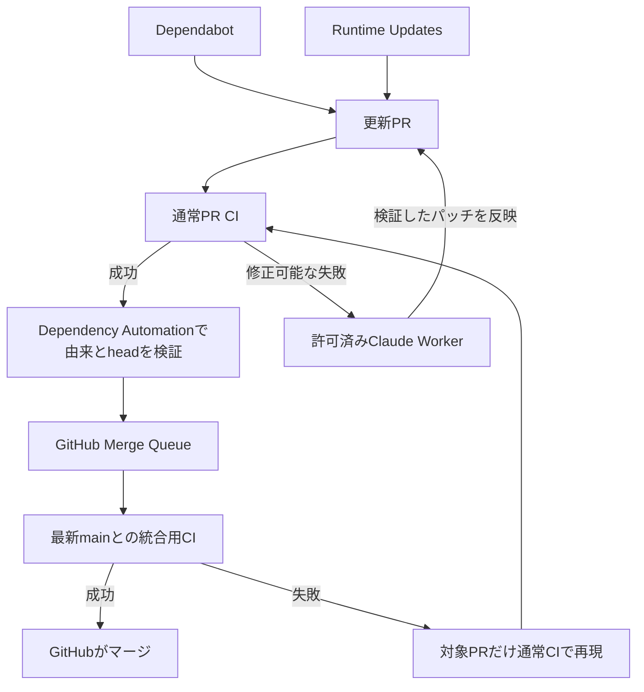

# 依存更新の自動化

更新自動化の入口は `dependency-queue.yml`（Dependency Automation）だけにする。
PRの検証、修正の許可、自動投入の判断をここで行う。実行順と最新mainでの統合検査・マージはGitHub Merge Queueが担当する。
アプリ・コンテナ・TerraformのPR検証は `ci.yml` の1実行にまとめる。
デプロイとTerraform本番適用は、それぞれの権限・承認を持つワークフローに残す。
構成全体は [WORKFLOWS.md](WORKFLOWS.md) を参照する。

| ファイル | 責務 |
| --- | --- |
| `runtime-updates.yml` | 日次の公式リリース探索、または指定ランタイムの再生成。整合した更新PRと公開記録を作る |
| `dependency-queue.yml` | Dependabotとcurrent-lineランタイムPRの検証、CI結果確認、修正の許可、標準キューへの投入 |
| `claude-dependency-worker.yml` | 許可されたCI失敗の修正、別runnerでのパッチ検証・反映。手動の認証テストも担当 |



## 運用

キューの状態・有効化・停止手順は [DEPENDENCY-QUEUE.md](DEPENDENCY-QUEUE.md)、
ランタイムの更新対象は [RUNTIME-UPDATES.md](RUNTIME-UPDATES.md) を参照する。
main追従とキューの処理はイベント起動だけで、定期ポーリングはない。
Runtime Updatesの日次実行は新しいリリースを見つけるためのもの。

- `DEPENDENCY_AUTOMERGE_ENABLED=true` でコントローラーを有効にする。
- `RUNTIME_AUTOMERGE_ENABLED=false` はランタイムPRを手動レビューへ回す。
- `CLAUDE_DEPENDENCY_REPAIR_ENABLED=true` は対応するCI失敗の修正を許可する。
- `no-automerge` はPRの自動処理を停止する。`no-rebase` はDependabotのmain追従を停止する。
- `no-runtime-update` はランタイムPRの再生成も停止する。
- `no-claude` または既存の `no-codex` はClaude修正を停止する。
- 旧ワークフローの自動案内コメントは停止理由にしない。現在の署名・差分・除外ラベルで判断する。

失敗したheadは修正待ちとして残し、他のPRを先に進める。新しいコミットが追加されると再び候補になる。
ワーカー完了イベントで再判定する。同じheadも完了済みワーカーの後に、各モードの最大8回の上限内で再試行する。
最終試行の完了後、モード別の上限に達した場合は理由と実行ログをPRへ一度だけ通知する。
途中の失敗はActionsログで確認し、同じエラーの案内コメントは毎回投稿しない。
セキュリティ検査の未成功や、アプリ修正の対象外のCI失敗も、現在のheadに理由とCIリンクを一度だけ案内する。
修正対象のCIはコントローラーが最新の実行から確認する。手動再試行でも修正回数の上限はリセットしない。

## Claudeの認証

`claude setup-token`で発行した値をActions Secret `CLAUDE_CODE_OAUTH_TOKEN`へ保存する。
トークンをPR、ログ、チャットへ貼らない。認証確認はClaude Dependency Repair Workerを
mainから`authentication_test=true`で実行する。PR番号などは指定不要で、PRは変更しない。
Claudeの利用枠・認証エラー・ワーカーの実行失敗はPRまたはActionsログへ表示する。
投入済みPRの停止はGitHubのキュー画面から対象を除外する。

## 検証と権限

- 対象は同一リポジトリのmain向けDependabot major/minor/patch、または管理Botのcurrent-lineランタイムPR。
  ランタイムの新系列・fork・人が追記した未検証コミットは自動マージしない。
- 元のDependabot署名と更新種別、許可した変更ファイルをAPIで検証する。
  GitHubのrebaseで署名が引き継がれなくても、元の署名済み差分と追従記録を毎回照合する。
  Terraformの本番自動適用でも同じ検証を使う。ただしprovider major更新の本番適用は承認を維持する。
- mainの必須CI、管理者への適用、標準Merge Queueを維持する。PRのCI完了後に現在のhead SHAを
  指定して投入し、GitHubが最新mainと統合したコミットで4つの必須チェックを再確認してからマージする。
- CI修正と競合解消を同じ隔離ワーカーで扱い、それぞれPR全体で最大8回、同じheadも実行完了後に再試行可能。
  起動予約・実行記録から重複実行を防ぐ。旧2回制限の記録は残し、新しい対応範囲はpolicy v2として数える。
  Supply Chain SecurityとDeployment Security Testsが成功していなければClaudeを起動しない。
- Claudeの実行ジョブは読み取り専用GitHub tokenを使う。コントローラーの秘密鍵や書き込みtokenは渡さない。
  別runnerが新しいcheckoutで、アプリのソース・設定・テスト・生成型を32ファイル以下・2000変更行以下で検証する。
  通常CI修正では依存manifest/lockを維持する。競合解消では承認したmainを取り込み、manifest/lockも統合する。
  依頼された直接依存の更新と、それ以外のmainの直接依存を維持し、元headと承認mainを親に持つcommitを作る。
  CI、保護ルール、資格情報、インフラの変更は許可しない。
- Workerはmain上の実際のコントローラーrun ID、対象CI（CI修正時）、現在のhead、競合解消時のmain SHA、許可記録を再検証する。
  PR targetイベントからモデルを直接起動せず、mainの実行へ引き継ぐ。同じ許可の重複使用を拒否する。
- パッチ反映はGitHub Appで行い、通常CIへ戻す。Claude自身にはpush・マージを任せない。
  コントローラーは現在のheadを指定してキューへ投入し、最終マージはGitHubが行う。

検証コマンド:

```sh
node --test .github/scripts/*.test.cjs
python3 -m unittest discover -s .github/scripts -p 'test_*.py'
actionlint .github/workflows/*.yml
```
