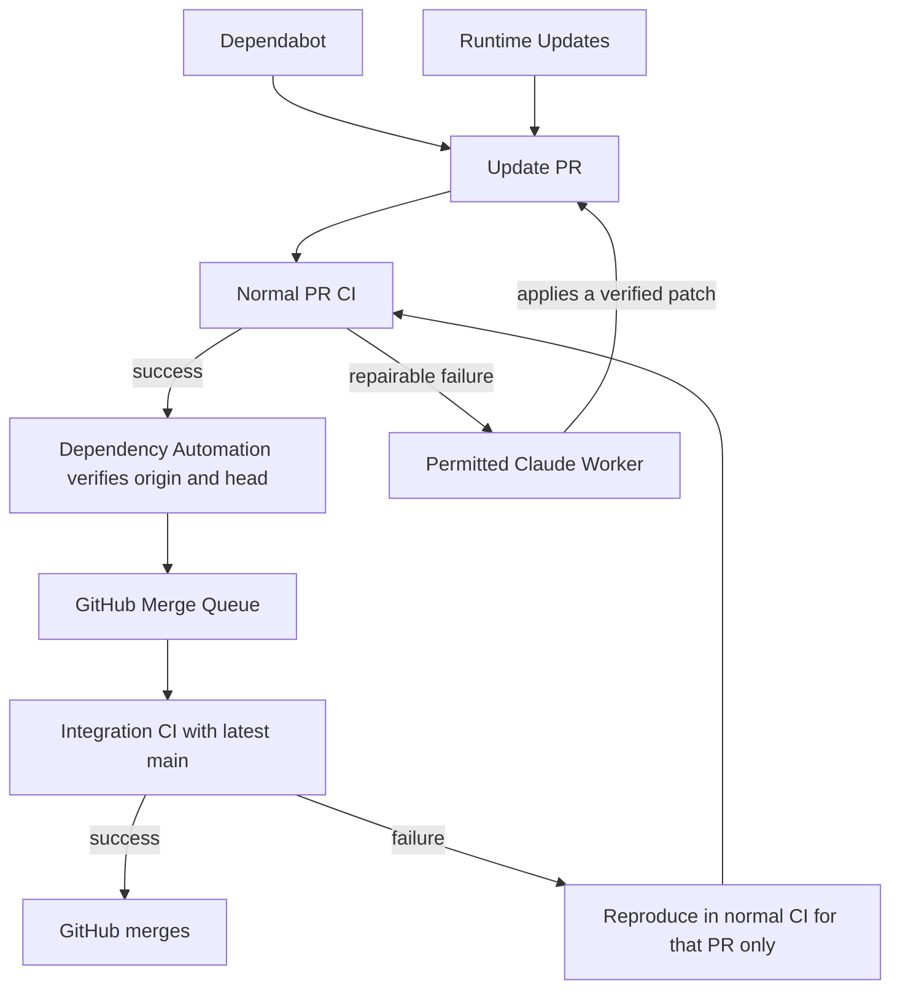

# Dependency update automation

`dependency-queue.yml` (Dependency Automation) is the only entry point for update automation.
It verifies PRs, permits repairs, and decides on automatic queueing. Execution order and
integration checks and merges against latest main are handled by GitHub Merge Queue.
PR validation for the app, containers, and Terraform runs in one `ci.yml` run.
Deployment and production Terraform applies stay in workflows holding their own permissions and approvals.
See [WORKFLOWS.md](WORKFLOWS.md) for the overall structure.

| File | Responsibility |
| --- | --- |
| `runtime-updates.yml` | Daily discovery of official releases, or regeneration of a specified runtime. Creates consistent update PRs and published records |
| `dependency-queue.yml` | Verifies Dependabot and current-line runtime PRs, checks CI results, permits repairs, and queues to the standard queue |
| `claude-dependency-worker.yml` | Repairs permitted CI failures, verifies and applies patches on a separate runner, and handles manual authentication tests |



## Operation

See [DEPENDENCY-QUEUE.md](DEPENDENCY-QUEUE.md) for queue state and enable/stop steps, and
[RUNTIME-UPDATES.md](RUNTIME-UPDATES.md) for runtime update targets.
Following main and queue processing are event-driven only; there is no scheduled polling.
Runtime Updates' daily run exists to find new releases.

- `DEPENDENCY_AUTOMERGE_ENABLED=true` enables the controller.
- `RUNTIME_AUTOMERGE_ENABLED=false` sends runtime PRs to manual review.
- `CLAUDE_DEPENDENCY_REPAIR_ENABLED=true` permits repairing eligible CI failures.
- `no-automerge` stops automatic processing of a PR. `no-rebase` stops Dependabot following main.
- `no-runtime-update` also stops regenerating runtime PRs.
- `no-claude` or the existing `no-codex` stops Claude repairs.
- Automatic guidance comments from old workflows are not a reason to stop. Decisions use the current signature, diff, and exclusion labels.

A failed head stays waiting for a repair while other PRs proceed. A new commit makes it a candidate again.
Worker completion events trigger a new decision. The same head can retry after a completed worker, within each mode's limit of eight attempts.
After the final attempt, reaching a mode's limit posts the reason and run log to the PR once.
Check Actions logs for failures along the way; the same error's guidance comment is not posted every time.
Security scans that did not succeed and CI failures outside app repair also post the reason and CI link once on the current head.
The controller checks the CI to repair from its latest run. Manual retries do not reset the repair limit.

## Claude authentication

Store the value issued by `claude setup-token` in the Actions secret `CLAUDE_CODE_OAUTH_TOKEN`.
Do not paste the token into PRs, logs, or chat. To check authentication, run the Claude Dependency Repair Worker
from main with `authentication_test=true`. It needs no PR number and changes no PR.
Claude usage, authentication errors, and worker failures appear on the PR or in Actions logs.
To stop a queued PR, remove it in GitHub's queue view.

## Verification and permissions

- Targets are same-repository Dependabot major/minor/patch PRs to main, or the managed bot's current-line runtime PRs.
  New runtime lines, forks, and unverified commits added by people do not automerge.
- The original Dependabot signature, update type, and permitted changed files are verified through the API.
  Even when a GitHub rebase does not carry the signature, the original signed diff and follow-up record are compared every time.
  Terraform's automatic production apply uses the same verification, but production applies of provider major updates keep approval.
- main's required CI, enforcement for administrators, and the standard Merge Queue stay in place. After PR CI completes, the PR is
  queued by its current head SHA, and GitHub rechecks the four required checks on a commit merged with latest main before merging.
- CI repair and conflict resolution use the same isolated worker, each up to eight attempts per PR; the same head can retry after a run completes.
  Reservations and run records prevent duplicate runs. Old records from the two-attempt limit remain, and the new scope counts as policy v2.
  Claude does not start unless Supply Chain Security and Deployment Security Tests succeeded.
- Claude's job uses a read-only GitHub token. It receives neither the controller's private key nor a write token.
  A separate runner verifies app source, configuration, tests, and generated types from a fresh checkout, within 32 files and 2000 changed lines.
  Normal CI repairs keep dependency manifests and lockfiles. Conflict resolution takes in the approved main and also merges manifests and lockfiles.
  It keeps the requested direct dependency update and main's other direct dependencies, creating a commit whose parents are the original head and the approved main.
  Changes to CI, protection rules, credentials, and infrastructure are not permitted.
- The worker reverifies the actual controller run ID on main, the target CI (for CI repairs), the current head, main's SHA for conflict resolution, and the permission record.
  A PR target event never starts the model directly; it hands off to a run on main. Reuse of the same permission is rejected.
- Patches are applied by a GitHub App and return to normal CI. Claude itself is not trusted to push or merge.
  The controller queues by the current head, and GitHub performs the final merge.

Verification commands:

```sh
node --test .github/scripts/*.test.cjs
python3 -m unittest discover -s .github/scripts -p 'test_*.py'
actionlint .github/workflows/*.yml
```
