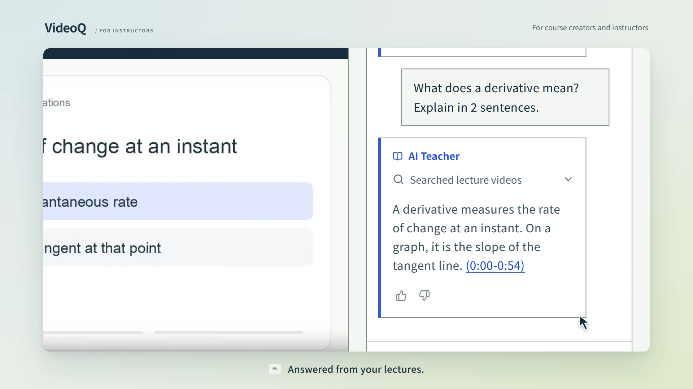

# VideoQ

**Automatic answers to student questions, from your lecture videos.**

VideoQ is for course creators, instructors, and training owners. Upload recordings or import YouTube lectures, group them into a course, and share it. Students ask in their own words and get an answer based on the course, with a timestamp that jumps to the explanation.

Answers use the course owner's allowance. Owners can review question history and feedback to see where students need help.

**[Try VideoQ](https://videoq.jp/en/) · [No-signup demo](https://videoq.jp/en/try) · [Developer docs](https://docs.videoq.jp/) · [Quick start](#quick-start)**

## Watch the demo

[](https://videoq.jp/demo/provider-demo-en.mp4?v=4)

**[▶ Play the English demo (30 seconds)](https://videoq.jp/demo/provider-demo-en.mp4?v=4)** · [Watch on the website with captions](https://videoq.jp/en/#landing-demo)

An instructor uploads a lecture and shares the course, a student asks a question and plays the cited moment, and the instructor finds that question in the conversation history.

*Recreated walkthrough using real course data and a captured AI answer; the opening is an illustration, and the English edit translates the interface, question, and answer. Waiting times have been shortened.*

## Features

- **Automatic answers across a course** — Students ask in their own words and get answers drawn from your lecture videos.
- **Check the source** — Follow timestamps from an answer to the relevant video scenes and review them in context.
- **Bring your own material** — Upload MP4, MOV, WebM, and other supported formats with a selectable spoken language, or import YouTube transcripts using your SearchAPI key.
- **Organize and share** — Group videos into courses, label them with tags, and give students access through share links (no login needed) or email invitations.
- **Review student questions** — Explore question history, answer feedback, analytics, and CSV exports.
- **Use Japanese or English** — Switch between Japanese and English interfaces.
- **Connect MCP clients** — Use Claude Code and other compatible tools to manage videos and courses or inspect question history through OAuth or API keys.
- **Manage usage** — Configure user quotas, storage limits, reindex jobs, and optional Stripe subscriptions.

> **New to the team?** Start with the [developer documentation](docs/README.md): [local setup](docs/getting-started/local-setup.md), [first walkthrough](docs/getting-started/first-walkthrough.md), and [codebase tour](docs/getting-started/codebase.md). Architecture and design references are also available there.

## Architecture

For the research behind the AI pipeline, see [AI methods and references](docs/reference/ai-references.md) ([Japanese translation](apps/docs/i18n/ja/docusaurus-plugin-content-docs/current/reference/ai-references.md)) and the reusable [BibTeX bibliography](docs/reference/ai-references.bib). It maps RAG, ReAct, Whisper, Otsu-inspired subtitle splitting, VideoSeek-inspired navigation, and the configured models to their original papers or official sources.

| Layer | Stack |
|---|---|
| Frontend | React 19, TypeScript, Vite, TanStack Query → Cloudflare Workers Static Assets |
| Web API | Hono + tRPC, Zod, Drizzle ORM → Cloudflare Workers |
| Authentication | Better Auth cookie sessions, API keys, OAuth provider; optional Google sign-in |
| Async jobs | Python worker → Amazon SQS / AWS Lambda |
| Database | Neon PostgreSQL + pgvector through Hyperdrive (local: PostgreSQL 17 + pgvector) |
| Object storage | Cloudflare R2 (local: Garage) |
| Edge state | Durable Objects (rate limits, task recovery scheduling, and chat execution) |
| External services | OpenRouter (hosted AI) / optional local AI, SearchAPI for YouTube transcripts, Mailgun email, Stripe billing |

Locally, `docker compose` runs Postgres, Garage, ElasticMQ, the Hono API (`wrangler dev`), the Python worker, a static frontend build, and a Caddy gateway on port 80.

For on-prem Kubernetes, the [Helm chart](charts/videoq/README.md) deploys a production
Node.js API, static web and Python workers against operator-provided PostgreSQL,
S3 storage, a persistent SQS-compatible queue and configured inference endpoints.
See the [on-prem guide](docs/guides/on-premises.md) for the runtime differences.

```text
Browser → Caddy → React (nginx)
               → Hono API → PostgreSQL / ElasticMQ (SQS)
Browser → Garage (signed uploads)          ↓
                              Python worker → PostgreSQL / Garage
```

The SPA shares the typed `/api/trpc` contract in `packages/trpc`. Hono also serves Better Auth, MCP, chat streaming, media, CSV exports, and the Stripe webhook. Browser authentication uses cookies; MCP uses API keys or OAuth access tokens.

Async processing runs transcription (saved interval by interval for uploaded files) → scene indexing, plus optional visual caches for uploads. Jobs are recorded in a database outbox and delivered to SQS, and the worker tracks job IDs to handle retries. The `TASK_SCHEDULER` Durable Object schedules recovery for pending deliveries and abandoned uploads. A daily `17 3 * * *` UTC cron performs retention cleanup and recovery; there is no five-minute polling cron.

Package READMEs: [`apps/`](apps/README.md) · [`apps/api/`](apps/api/README.md) · [`apps/web/`](apps/web/README.md) · [`apps/worker/`](apps/worker/README.md) · [`apps/docs/`](apps/docs/README.md) · [`apps/demo-video/`](apps/demo-video/README.md) · [`packages/trpc/`](packages/trpc/README.md)

## Quick Start

### Requirements

- [Docker](https://docs.docker.com/get-docker/) and [Docker Compose](https://docs.docker.com/compose/install/) installed
- An [OpenRouter API key](https://openrouter.ai/settings/keys) for the default AI configuration
- A [SearchAPI API key](https://www.searchapi.io/) if you want to import YouTube videos (configured per user in Settings)
- Node.js and npm for the account promotion command below and development outside Docker. CI and the images use the version in `.node-version`
- Python 3.12+ only if you run or test the Python worker outside Docker. CI and the images use the version in `.python-version`

### Step 1: Get an OpenRouter API key for the default setup

1. Go to [OpenRouter API keys](https://openrouter.ai/settings/keys)
2. Sign up or log in
3. Create a key
4. Copy the key, which starts with `sk-or-...`

The setup below uses OpenRouter for transcription, embeddings, and chat. Optional local AI configuration is described [below](#optional-reduce-costs-with-local-ai).

### Step 2: Set up VideoQ

```bash
# Clone the project and enter the directory
git clone https://github.com/videoq-jp/videoq.git
cd videoq

# Copy the environment file
cp .env.example .env
```

Open `.env` and set at least:

```bash
OPENROUTER_API_KEY=your-openrouter-api-key
OPENAI_BASE_URL=https://openrouter.ai/api/v1
LLM_MODEL=openai/gpt-6-luna
EMBEDDING_MODEL=openai/text-embedding-3-small
WHISPER_BACKEND=openrouter

# Docker API startup currently forwards AUTH_JWT_SECRET as the auth fallback.
# AUTH_JWT_SECRET: openssl rand -base64 48
# USER_SECRET_ENCRYPTION_KEY: openssl rand -base64 32 | tr '+/' '-_' | tr -d '='
AUTH_JWT_SECRET=
USER_SECRET_ENCRYPTION_KEY=
```

A fixed `OPENROUTER_API_KEY` is the simplest option for local development. Shared
and production deployments should prefer workload identity federation: configure
separate `OPENROUTER_FEDERATION_POLICY_ID` values for the API and worker, using AWS
STS identities and OpenRouter Business/Enterprise policies.
The hosted models are GPT-6 Luna, 1536-dimensional `text-embedding-3-small`, and
`openai/whisper-large-v3-turbo`.
OpenRouter uses qualified `openai/...` model IDs. The adapters also qualify the
unprefixed default model names when the selected endpoint is OpenRouter.
This alias alone does not require rebuilding existing embedding vectors.

For Cloudflare, configure the API policy ID and `AWS_REGION` in production
Wrangler vars and grant STS token permission to its existing AWS principal. For
Lambda, set Terraform `openrouter_federation_policy_id`; it uses its execution
role. See the [WIF setup and release runbook](docs/operations/openai-transcription.md).
For Helm, configure `ai.federationPolicyId` / `ai.federationAudience` and supply
an AWS identity to the runtime. Local inference remains available through the
local overlays. Without a policy, `OPENROUTER_API_KEY` remains a development
option. Remove stale endpoint overrides when selecting the shared provider.
A configured federation policy takes precedence over fixed keys on OpenRouter
and never falls back to them after an exchange failure.

Before production use, verify Whisper returns real segment timestamps using
`verbose_json`, and run the opt-in structured-answer live test. No fabricated
subtitle timing is accepted. See the [release runbook](docs/operations/openai-transcription.md),
[OpenRouter transcription](https://openrouter.ai/docs/guides/overview/multimodal/stt),
and [embeddings](https://openrouter.ai/docs/api_reference/embeddings).

Answer generation and image inspection share `LLM_MODEL`. The template selects GPT-6 Luna through OpenRouter (`openai/gpt-6-luna`). With visual Q&A enabled, the model must support image input as well as tool calling and strict JSON output. See [model settings](docs/architecture/prompt-engineering.md#model-settings-and-limits) and [model references](docs/reference/ai-references.md#gpt-6-luna).

Embedding dimensions are fixed at 1536 in the API, worker, and DB. The templates use `openai/text-embedding-3-small` through OpenRouter; no dimension setting is needed. Configure the same provider and model for both runtimes. See [embedding configuration and diagnostics](docs/guides/embeddings.md).

Docker Compose supplies development-only fallback secrets when these fields are blank. The API container generates `apps/api/.dev.vars` using [`docker-dev.sh`](apps/api/scripts/docker-dev.sh), which currently forwards `AUTH_JWT_SECRET`, not `BETTER_AUTH_SECRET`. Host-run API development and production use `BETTER_AUTH_SECRET` directly. Configure independent secrets for shared deployments.

### Step 3: Start VideoQ

```bash
# Start all services. The first run may take a few minutes.
# Drizzle migrations run automatically via the `migrate` service.
docker compose up --build -d
```

Check service state and logs if startup or video processing fails:

```bash
docker compose ps -a
docker compose logs --tail=100 migrate api worker
```

`migrate` and `garage-init` are one-shot services; exiting with code 0 is expected. The API provides `/health` for liveness and `/ready` for database readiness, both accessible through `http://localhost`.

Optional Vite HMR for frontend work:

```bash
docker compose --profile dev up -d web-dev
# → http://localhost:3000
```

### Step 4: Create an admin user

1. Open [http://localhost/signup](http://localhost/signup) and create an account.
2. Complete email verification if Mailgun is configured.
   For a bare local stack without Mailgun, promote the account
   (this also activates it):

```bash
npm ci
npm run user:admin --workspace @videoq/api -- your-username-or-email
```

If a migrated local account reports `Password not found`, set a new local-only
password. The command reads it from `VIDEOQ_LOCAL_PASSWORD` (12–128 characters) and
refuses non-local databases:

```bash
read -rsp 'New local password (12–128 characters): ' VIDEOQ_LOCAL_PASSWORD
echo
export VIDEOQ_LOCAL_PASSWORD
npm run user:password:local --workspace @videoq/api -- your-username-or-email
unset VIDEOQ_LOCAL_PASSWORD
```

3. Log in at [http://localhost/login](http://localhost/login).

### Step 5: Start using VideoQ

Open [http://localhost](http://localhost) in your browser.

**Useful links:**

- **Admin UI:** [http://localhost/admin](http://localhost/admin) for users, quotas, and reindex jobs
- **Garage S3 API:** `http://127.0.0.1:9000` (bucket status: `docker compose exec garage /garage bucket info videoq-media`)
- **API:** [http://localhost:8787/health](http://localhost:8787/health)
- **PostgreSQL:** `127.0.0.1:55432`
- **ElasticMQ:** `http://127.0.0.1:9324` (SQS endpoint), [statistics UI](http://localhost:9325)

**First steps:**

1. Log in with the account you promoted
2. Upload a video, or save a SearchAPI key in Settings and import a YouTube lecture
3. Create a course, add videos, wait for processing, and ask a question
4. Open cited scenes to verify the answer

### Free tier on signup

New accounts receive a monthly free tier automatically (override per user later in Admin):

| Setting | Default |
|----------|-------------|
| Max video upload size (MB) | 200 (`MAX_VIDEO_UPLOAD_SIZE_MB`) |
| Storage limit (GB) | 1 (`DEFAULT_STORAGE_LIMIT_GB`) |
| Processing limit (minutes / month) | 45 (`DEFAULT_PROCESSING_LIMIT_MINUTES`) |
| AI answers limit (per month) | 30 (`DEFAULT_AI_ANSWERS_LIMIT`) |

The `DEFAULT_*` quota variables accept `null` or `unlimited` for no cap; `0` is a hard zero quota. `MAX_VIDEO_UPLOAD_SIZE_MB` is a numeric upload limit. In Admin, leave nullable quota fields blank to set unlimited. AI answers and processing usage reset each UTC month.

For Docker development, use Admin to change user quotas. API runtime variables come from `wrangler.jsonc` and the subset written by `docker-dev.sh`; adding an arbitrary API variable to the root `.env` does not automatically expose it to Hono. In particular, signup quota overrides are not currently forwarded by that script.

<details>
<summary><strong>Optional: object storage notes (Garage / R2 / S3)</strong></summary>

**Local default:** Docker Compose starts a single-node Garage instance and configures the API + worker to use it. Browser uploads go to `http://127.0.0.1:9000`; containers use `http://garage:3900`, with region `garage`. `garage-init` applies bucket CORS before the API and worker start. Data and metadata persist in the `garage_data` volume. See the [local storage guide](infra/garage/README.md) for credentials, inspection, verification, and migration from an existing MinIO stack.

**Production:** Use Cloudflare R2 (or another S3-compatible store). Set the API secrets / vars described in [`infra/DEPLOY.md`](infra/DEPLOY.md), including `R2_*` credentials and `USE_S3_STORAGE=true` for the worker / frontend as needed. Browser uploads also require the versioned R2 CORS policy in `apps/api/r2-cors.production.json`.

Example API runtime variables / secrets for R2:

```bash
USE_S3_STORAGE=true
R2_ACCESS_KEY_ID=your-r2-access-key
R2_SECRET_ACCESS_KEY=your-r2-secret-key
R2_BUCKET_NAME=your-bucket
R2_S3_ENDPOINT=https://<account-id>.r2.cloudflarestorage.com
R2_S3_REGION=auto
```

The deployed API uses the `VIDEO_BUCKET` binding for object metadata and deletion. The R2 S3 credentials are used to sign browser URLs and by the Python worker. In Lambda, store R2 credentials under `R2_ACCESS_KEY_ID` / `R2_SECRET_ACCESS_KEY`; AWS credential variables belong to the execution role.

The checked-in Compose stack explicitly configures Garage endpoints and credentials. Switching it to external storage requires updating those service settings as well as browser CORS and the publicly reachable storage URL.

After editing runtime values in the root `.env`, recreate affected containers to load them:

```bash
docker compose up -d --force-recreate api worker
```

Frontend `VITE_*` values are build-time settings; changes require rebuilding `web`.

</details>

<a id="optional-reduce-costs-with-local-ai"></a>

<details>
<summary><strong>Optional: reduce costs with local AI</strong></summary>

**This step is optional.** Skip it if the default hosted setup works for you.

Transcription, chat, and embeddings can use local services. Configure each component together with the API and worker that consume it.

<details>
<summary><strong>Mac transcription with whisper.cpp</strong></summary>

Run whisper.cpp natively on macOS to use Apple Silicon's Metal backend.
The on-prem Kubernetes recipes use whisper.cpp on CPU or vLLM on NVIDIA GPUs,
behind a private transcription gateway.
Both connect through `WHISPER_BACKEND=local`. Build the pinned submodule with
CMake and a C++ toolchain; install FFmpeg on the Mac for MP3 conversion.

**Quick setup:**

```bash
# 1. Fetch whisper.cpp from the VideoQ root directory
git submodule update --init --recursive
cd whisper.cpp

# 2. Build
cmake -B build -DCMAKE_BUILD_TYPE=Release
cmake --build build -j --config Release

# 3. Download a model
bash ./models/download-ggml-model.sh large-v3-turbo

# 4. Start the server
./build/bin/whisper-server -m models/ggml-large-v3-turbo.bin \
  --host 127.0.0.1 --port 8080 --inference-path /audio/transcriptions \
  --convert -l auto
```

`--convert` is required for the worker's MP3 uploads. Keep timestamps enabled.
Use `-l ja` instead of `-l auto` to fix recognition to Japanese. The server loads
the selected local model at startup; it does not download a model per request.

**Configure VideoQ:**

In another terminal at the VideoQ root, edit `.env`:

```bash
WHISPER_BACKEND=local
WHISPER_LOCAL_URL=http://host.docker.internal:8080
```

Recreate the worker to load the changed environment:

```bash
docker compose up -d --force-recreate worker
```

For a worker running directly on the Mac, use `http://127.0.0.1:8080` instead.
The base URL has no `/v1` suffix for this whisper.cpp command. Keep this
unauthenticated development server bound to loopback. See the
[local inference guide](docs/guides/local-inference.md#mac-development-with-whispercpp)
for endpoint differences and the real-audio acceptance check.

</details>

<details>
<summary><strong>Local chat, embeddings and Whisper</strong></summary>

Use llama.cpp for the default CPU recipe or vLLM for NVIDIA GPU inference.
Chat and embeddings use separate private OpenAI-compatible APIs; transcription
uses the private whisper.cpp/vLLM gateway. See the [local inference guide](docs/guides/local-inference.md)
and the [inference chart](charts/videoq-inference/README.md) for matching
application overlays, model provisioning and acceptance commands.

Set `EMBEDDING_BASE_URL` and the matching served model alias in both API and worker.
`OPENAI_BASE_URL` selects chat independently. Private servers without
API authentication use `local-inference` as a placeholder key. Text-only models
require `VIDEO_VISUAL_ENABLED=false`; hosted credentials are unnecessary when
chat, embeddings and Whisper all use validated private services.

Changing embedding models requires maintenance, backups and complete vector
regeneration before resuming search, even when dimensions remain 1536.
See [diagnostics and migration constraints](docs/guides/embeddings.md).

</details>

</details>

## Development

See [the workflow map](.github/WORKFLOWS.md) for CI, deployment, automatic dependency updates, and operations checks.

Run npm commands from the repository root. Dependencies for `apps/api`, `apps/demo-video`, `apps/docs`, `apps/web`, and `packages/trpc` share the root lockfile.

```bash
npm ci
npm run typecheck
npm run lint
npm test
npm run build
```

`npm test` runs API unit / Workers runtime tests and frontend tests. API database integration tests additionally require `QUOTA_TEST_DATABASE_URL` pointing to a test PostgreSQL instance with pgvector and permission to create test databases.

### Documentation site

Read the published docs in [English](https://docs.videoq.jp/) or [Japanese](https://docs.videoq.jp/ja/).

The Docusaurus site reads English Markdown from [`docs/`](docs/README.md) and Japanese
translations from `apps/docs/i18n/ja/docusaurus-plugin-content-docs/current/`.
English is the default at `/`; the header language menu switches to Japanese at `/ja/`.
Both languages include Mermaid diagrams and local full-text search.
Documentation changes merged into `main` are automatically published by
[CD](.github/workflows/cd.yml) after CI succeeds.

```bash
npm run dev:docs      # http://localhost:3001
npm run dev:docs -- --locale ja  # Japanese only: http://localhost:3001/ja/
npm run build:docs    # Both languages: apps/docs/build
npm run preview:docs  # Preview the build, including search, on port 3001
npm run deploy:docs   # Build and publish the current working tree to docs.videoq.jp
```

The development server runs one language at a time. Build and preview to check
the language switcher and search; search indexes are generated during the build. See
[`apps/docs/README.md`](apps/docs/README.md) for editing and hosting settings.

### Frontend and API on the host

For frontend-only work against the Compose API:

```bash
VITE_API_URL=/api VITE_USE_S3_STORAGE=true npm run dev:web
# http://localhost:3000; Vite proxies /api to 127.0.0.1:8787
```

To also run Hono outside Docker, stop the Compose API to release port 8787, then prepare Wrangler's variables:

```bash
docker compose stop api
cp apps/api/.dev.vars.example apps/api/.dev.vars
```

Set `BETTER_AUTH_SECRET`, `USER_SECRET_ENCRYPTION_KEY`, and `OPENROUTER_API_KEY` in `apps/api/.dev.vars`. For the hosted setup above, also set:

```dotenv
BETTER_AUTH_URL=http://localhost:3000
FRONTEND_URL=http://localhost:3000
OAUTH_ISSUER_URL=http://localhost:3000
OPENAI_BASE_URL=https://openrouter.ai/api/v1
LLM_MODEL=openai/gpt-6-luna
EMBEDDING_MODEL=openai/text-embedding-3-small
```

Keep the Garage / ElasticMQ settings from `.dev.vars.example`, use the same user-secret encryption key as the Python worker, then run `npm run dev:api` in another terminal. Wrangler's local Hyperdrive connection targets `localhost:55432`; override it if you changed the database credentials. The Compose dependencies and Python worker continue running.

Restarting the Compose API regenerates `.dev.vars`, so keep host-only configuration separately if you switch between these workflows. MCP OAuth discovery additionally needs `/.well-known/*` forwarding, as shown in [`Caddyfile.dev`](Caddyfile.dev); Vite currently proxies `/api`, `/health`, and `/ready` only.

### Database changes

Edit [`apps/api/src/db/schema/`](apps/api/src/db/schema/), then generate and verify migrations:

```bash
npm run db:generate -- --name describe_the_schema_change
npm run db:check
npm run db:verify
npm run db:migrate
```

Do not hand-edit generated DDL SQL, snapshots, or the journal. Data-only backfills use `npm run db:generate:custom -- --name describe_the_data_change` and must start with `-- drizzle-kit:custom`; custom migrations must not contain DDL. `db:verify` checks migration provenance, and the API database integration tests apply the full migration history to an empty database.

`db:migrate` uses `DATABASE_URL` when exported, otherwise the local `postgres:postgres` connection on port 55432. Root `.env` values are not automatically loaded by Drizzle Kit. See the [API README](apps/api/README.md) for details.

### Python worker

```bash
cd apps/worker
python3 -m venv .venv
source .venv/bin/activate
pip install -e ".[dev]"
python -m pytest tests/ -q
```

PostgreSQL integration tests additionally use `DATABASE_URL`. Running transcription outside Docker requires FFmpeg and the database, storage, queue, and AI environment settings described in the [worker README](apps/worker/README.md).

### Dependency updates

[Dependabot](.github/dependabot.yml) checks for version updates every Monday at
09:00 Asia/Tokyo. It covers the root npm workspaces, the Python worker's
`pyproject.toml` / `uv.lock`, GitHub Actions, Dockerfiles, Docker Compose,
Terraform (including `infra/bootstrap`), and the optional `whisper.cpp` submodule.
[Runtime Updates](.github/RUNTIME-UPDATES.md) separately checks daily for Node.js,
Python, npm, pip, and uv releases.

Dependabot alerts and security updates are separate repository settings under
**Settings → Advanced Security**; keep both enabled. After CI succeeds,
[Dependency Automation](.github/dependency-automation.md) verifies each update's
origin and files, then queues eligible Dependabot major/minor/patch updates and
current-line runtime PRs in GitHub Merge Queue. It can send repairable CI failures
to an isolated Claude worker. New runtime lines and PRs with unverified changes
require human review. Terraform provider minor/patch updates also apply
automatically after merge; ordinary infrastructure changes and provider majors
retain production approval. CI and production worker builds install hash-verified
binary dependencies from `uv.lock`.

## Deployment

The production topology is Cloudflare Workers (separate frontend, API, and docs) + Hyperdrive, Neon PostgreSQL, Cloudflare R2, and an ARM64 Python Lambda consuming SQS. Follow [`infra/DEPLOY.md`](infra/DEPLOY.md) for provisioning, secrets, migrations, CORS, and deployment checks.

- Frontend: `videoq-web` Worker + Static Assets, configured in `apps/web/wrangler.jsonc`; GitHub Actions CD deploys after successful main CI.
- API and worker: [GitHub Actions CD](.github/workflows/cd.yml) applies database migrations before deployment. Terraform in `infra/` manages AWS resources.
- Authentication: configure `BETTER_AUTH_SECRET`, public URLs, and Mailgun for verification / invitation email; Google sign-in is optional.
- Billing: configure Stripe keys, products, and the webhook using the [billing setup](docs/billing/stripe-dashboard.md).

### HTTPS with Docker Compose

Caddy accepts a public hostname through `SITE_ADDRESS`, but the checked-in stack runs `wrangler dev` with development settings and signs uploads for `http://127.0.0.1:9000`. Setting a domain in `.env` alone does not configure a public deployment: authentication origins, CORS, API variable forwarding, secrets, and a browser-accessible HTTPS storage endpoint also need configuration. Use the production deployment guide above for the maintained cloud setup.

## MCP (Model Context Protocol) Integration

VideoQ exposes a remote MCP server at `/api/mcp` (Streamable HTTP via `@hono/mcp`). Connect a compatible client using the endpoint URL and an API key, or use the OAuth authorization flow. Older clients can use the `mcp-remote` bridge below.

> 🛡️ **Permission policy:** Read tools accept `read_only` API keys or OAuth tokens with `videoq.read`. Video upload and course management tools require an `all` API key or the OAuth `videoq.write` scope. The server sets each API key's permissions from the type selected at creation. Sending RAG chat questions is intentionally excluded from MCP.

### Available tools

VideoQ exposes 7 read-only tools and 5 write tools. The MCP metadata and tests enforce
that split, including each tool's input/output schema and safety annotations.

| Tool | Purpose |
|---|---|
| `list_videos` / `get_video` | List videos and view details (with opt-in, bounded transcript chunks) |
| `request_video_upload` / `confirm_video_upload` | Upload a local video through a signed object-storage URL and start processing |
| `create_youtube_video` | Register and import a YouTube lecture URL |
| `list_courses` / `get_course` | List courses and their member videos |
| `create_course` | Create a course |
| `add_video_to_course` | Add an uploaded video to a course |
| `list_tags` | List tags |
| `get_chat_history` | Chat history for a course (with feedback) |
| `get_chat_analytics` | Question counts, period, daily time series, feedback aggregates |

List tools support `limit` / `offset` pagination. General lists default to 20 and allow at most 100 items; chat history defaults to 10 and allows at most 25. `get_course` paginates member videos separately with `video_limit` / `video_offset`. `get_video` omits the transcript by default; request bounded chunks with `include_transcript`, `transcript_offset`, and `transcript_limit`.

The three create/reserve tools (`request_video_upload`, `create_youtube_video`, and `create_course`) require an `idempotency_key`. Generate one stable value per logical operation and reuse it only when retrying the same arguments. Upload confirmation and course membership addition are also safe to retry.

### Setup

#### Step 1: Issue an integration API key

Log in to VideoQ and issue a `vq_...` key from **Settings → Integration API Keys**, then copy it. Select `all` to upload videos or manage courses; `read_only` is enough for analytics.

#### Step 2: Register the endpoint with your MCP client

The endpoint URL is your VideoQ host followed by `/api/mcp` — for example, `http://localhost/api/mcp` for a local Docker setup or `https://your-domain.example.com/api/mcp` in production. Authenticate with `Authorization: Bearer vq_...` (or the equivalent `X-API-Key` header).

For **Claude Code**:

```bash
claude mcp add --transport http videoq https://your-domain.example.com/api/mcp \
  --header "Authorization: Bearer vq_xxxxxxxxxxxxxxxx"
```

For **Claude Desktop / claude.ai (built-in connector, OAuth 2.1)**, paste just the MCP URL into **Settings → Connectors → Add custom connector** and approve the consent screen. No API key needed — VideoQ implements OAuth 2.1 + Dynamic Client Registration (RFC 7591) per the MCP Authorization spec.

```
https://your-domain.example.com/api/mcp
```

The client discovers the authorization server through `/.well-known/oauth-protected-resource/api/mcp` and `/.well-known/oauth-authorization-server/api/auth`, registers at `/api/auth/oauth2/register`, and runs the authorization-code flow with PKCE. The authorization server issuer is `{public-origin}/api/auth`, and the protected resource is `{public-origin}/api/mcp`. VideoQ enforces `videoq.read` / `videoq.write` scopes. Revoke grants from **Settings → Connected Apps**.

For your own production instance, complete the [deployment setup](infra/DEPLOY.md). Set the API runtime URL variables to the public HTTPS origin:

```dotenv
BETTER_AUTH_URL=https://videoq.example.com
FRONTEND_URL=https://videoq.example.com
OAUTH_ISSUER_URL=https://videoq.example.com
```

After deployment, confirm that the MCP endpoint and OAuth metadata are reachable before registering the connector (an unauthenticated MCP request can return `401`):

```text
https://videoq.example.com/api/mcp
https://videoq.example.com/.well-known/oauth-authorization-server/api/auth
https://videoq.example.com/.well-known/oauth-protected-resource/api/mcp
```

If you need to fall back to the `mcp-remote` bridge for an older client, configure it with your API key instead:

```json
{
  "mcpServers": {
    "videoq": {
      "command": "npx",
      "args": [
        "mcp-remote",
        "https://your-domain.example.com/api/mcp",
        "--header",
        "Authorization: Bearer vq_xxxxxxxxxxxxxxxx"
      ]
    }
  }
}
```

Config file locations:

- macOS: `~/Library/Application Support/Claude/claude_desktop_config.json`
- Windows: `%APPDATA%\Claude\claude_desktop_config.json`

**Cursor** and other Streamable HTTP-capable clients use the same URL + header pattern.

#### Step 3: Verify

Restart the client and confirm that the MCP server appears as `videoq`. Try prompts like "Create a course named Physics", "Upload lecture.mp4 and add it to the Physics course", or "Analyze the chat history for course 1".

For a local file, Claude Code generates an idempotency key, calls `request_video_upload`, uploads the file with an HTTP `PUT` using the returned URL and required headers, and then calls `confirm_video_upload`. The video bytes do not pass through the Worker or MCP JSON payload. Retrying the prepare call after confirmation returns the current video state without minting an overwrite-capable PUT URL.

### Troubleshooting

- **`401 Unauthorized`** → The API key (or OAuth token) is missing, malformed, or revoked. Reissue from Settings and update the header, or re-approve the OAuth connector.
- **`404 Not Found`** → The URL is wrong. Confirm the host and the `/api/mcp` path.
- **OAuth connector cannot discover the server** → Confirm that `https://<host>/.well-known/oauth-authorization-server/api/auth` and `https://<host>/.well-known/oauth-protected-resource/api/mcp` return JSON. Reverse proxies must forward `/.well-known/*` to Hono, and metadata must advertise the public origin.

## Repository layout

```text
apps/api/        Hono + tRPC on Cloudflare Workers (or Node.js on-prem)
apps/web/        React SPA
apps/worker/     Python async pipeline (SQS / Lambda)
apps/docs/       Documentation site and Japanese translations
apps/demo-video/ Remotion demo films
apps/inference/  Private speech gateway and engine images for on-prem
packages/trpc/   Shared Hono ↔ React tRPC router and contract
package.json     npm workspace root
charts/          Helm charts for on-prem application and inference
infra/           Terraform (SQS, Lambda, ECR, IAM) + deploy notes
docs/            Architecture, design, and operations docs
assets/brand/    Brand masters
whisper.cpp/     Optional local transcription server (Git submodule)
.github/workflows/   CI, CD, Terraform, Cloudflare resource management
docker-compose.yml   Local full stack
Caddyfile.dev        Local gateway and protocol routing
```

## Contributing

Found a bug or want to add a feature? Contributions are welcome.

1. Fork the repository
2. Create a feature branch
3. Make your changes
4. Add tests as needed
5. Submit a pull request

For frontend UI changes, follow the [Storybook change and review workflow](apps/web/STORYBOOK.md) to update the relevant stories and share verification results in your PR.

## Citation

- Hironobu Fujiyoshi. "Using Generative AI in Education in an Era of Living with AI: 'Fujiyoshi AI Teacher'" (title translated from Japanese). Information Processing Society of Japan, *Information Processing*, Vol.66, No.11 (2025).
  - [https://ipsj.ixsq.nii.ac.jp/records/2004788](https://ipsj.ixsq.nii.ac.jp/records/2004788)

## License

See the [LICENSE](LICENSE) file for details.
