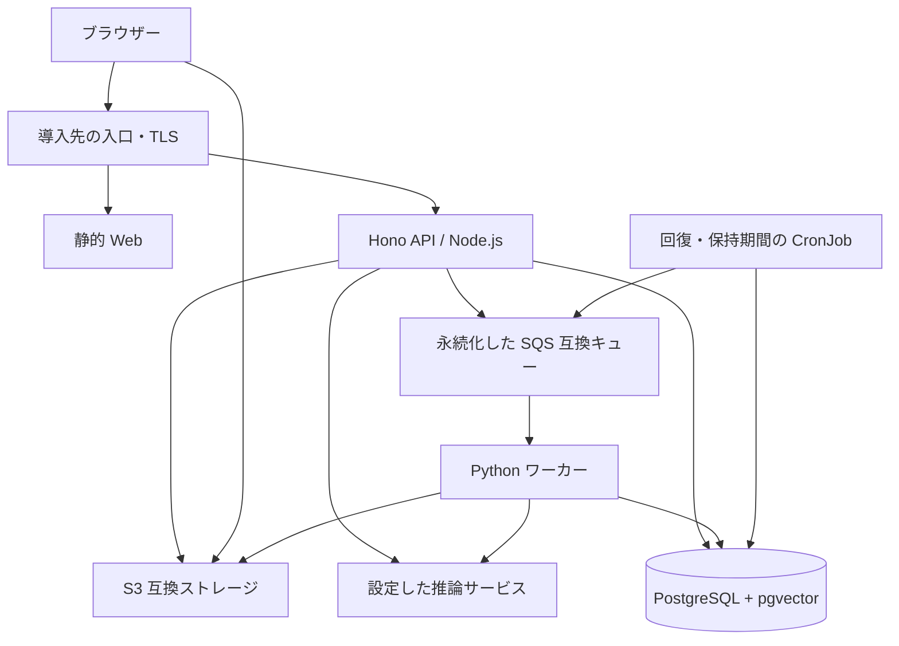

# VideoQ をオンプレで動かす

LLM・埋め込み生成・Whisper も社内で動かす場合は、[ローカル推論](local-inference.md)
の手順を使います。アプリ用 Chart の標準設定は外部 OpenAI API です。
ローカル構成では、推論用 Chart と接続先を切り替える設定を明示的に適用します。

VideoQ の Web・Node.js API・Python ワーカーを、既存の Kubernetes に配置できます。
小規模な導入では、単一ノードの K3s から始められます。配布にはリポジトリの
[Helm Chart](https://github.com/yukiharada1228/videoq/tree/main/charts/videoq)
を使います。Chart の README に、必要な外部基盤、イメージの作成、設定例、導入・更新・切り戻しの手順をまとめています。

## 配置する構成

Chart はアプリの配置と更新を担当します。DB・動画保存・キュー・推論サーバー・クラスタ・DNS・証明書は導入先で用意し、接続先を設定します。既存の社内基盤も利用できます。GPU 推論は別のワークロードまたは別マシンに置き、API と動画ワーカーから呼び出します。

## クラウド構成との違い

| 機能 | クラウド | オンプレ |
|---|---|---|
| HTTP・チャット | Workers / ChatExecution DO | 同じ HTTP 処理を通る Hono の Node.js サーバー |
| DB 接続 | Hyperdrive | PostgreSQL への直接接続とプロセス単位のプール |
| 共有レート制限 | RateLimiter DO | PostgreSQL の行ロックで直列化 |
| 未配送・放棄アップロードの回復 | TaskScheduler DO のアラーム | DB に残った対象を毎分拾う CronJob |
| 保持期間の掃除 | Workers の日次 cron | UTC で動く日次 CronJob |
| 動画操作 | R2 バインディング・署名 URL | S3 API・署名 URL |
| 動画ジョブ | Lambda の SQS トリガー | 常駐 Python ワーカーによるロングポーリング |

Node.js の起動処理は Durable Objects を読み込まず、本番用の認証設定を使います。起動時に必要な鍵・接続先も検証します。SSE と tRPC のチャットは、既存の認証・権限・利用枠確認を通ります。

## 初回導入の手順

1. PostgreSQL 17 と pgvector、非公開の S3 バケット、永続化した SQS 互換キューとデッドレターキューを用意します。バケットの CORS と、ブラウザーから公開 S3 エンドポイントへの到達も設定します。
2. Chart の README に沿って API・Web・オンプレワーカーのイメージを作成し、クラスタから取得できるレジストリへ置きます。
3. Namespace と、導入先が管理する Secret を事前に作成します。API とワーカーの暗号鍵は共通にします。
4. `charts/videoq/examples/site.yaml` をリポジトリ外にコピーし、例示のホスト名・接続先・イメージ名・証明書を置き換えます。Helm の lint と template で確認します。
5. Chart をインストールします。先にマイグレーション Job が成功してから、アプリが配置されます。
6. `/ready` の成功を確認し、API Pod 内で `node dist/provision-user.mjs --admin --username site_admin --email admin@example.com` を実行します。返された一度限りの設定リンクを管理者本人に渡してパスワードを設定し、短い動画の文字起こし・Q&A・引用時刻の再生まで試します。

`registry.example.edu` のイメージは、導入先で作成するイメージの例です。このリポジトリがそのアドレスで配布しているわけではありません。閉域環境ではイメージとパッケージ化した Chart を先に搬入し、チャット・埋め込み・文字起こしの全接続先をローカルサービスに設定します。オンプレ版では Stripe・Google ログイン・YouTube/SearchAPI・Mailgun を無効にします。

チャットの接続処理は、認証不要の OpenAI 互換サーバーでも空でない `OPENAI_API_KEY` を必要とします。その場合は `local-inference` などのダミー値を Secret に設定します。Ollama の埋め込みにはこの鍵は不要です。

## 運用で決めること

API とワーカーは個別に増やせます。DB の接続上限には API 全レプリカ、ベクトル検索、ワーカー、定期処理の接続を見込みます。埋め込みモデルを変更するときは、次元数が同じでも既存データの再索引計画が必要です。

`api.trustedProxyHops` は、導入先のプロキシ構成と転送ヘッダーの扱いを確認してから設定します。既定値では TCP の接続元を IP 制限に使います。入口では SSE のバッファリングを無効にし、回答の生成時間に合うタイムアウトを設定します。

ワーカーは SIGTERM を受けると新しい処理を取らず、実行中の処理を完了してから応答を削除して終了します。既定の実行上限は840秒で、900秒の DB リースより短くしています。中断した処理は、保存したチェックポイントとキューの再試行で回復します。CronJob の失敗、キューの滞留時間、デッドレターを監視してください。

DB・動画データ・暗号鍵はバックアップ対象です。Helm の切り戻しで戻るのはアプリの配置設定なので、SQL や動画データの復元手順は別に検証します。更新前のマイグレーションは、まだ稼働している旧バージョンとも互換性を保つ必要があります。破壊的な変更、Secret の更新、復旧の詳しい手順は Chart の README を参照してください。

## オンプレ版の画面と利用者管理

オンプレ用 Web イメージと Node API は、オンプレ版の設定で起動します。
LP・料金・商用サービス向けの法務ページ・公開の新規登録・課金／アップグレード表示は除外し、
未ログイン時はログイン画面へ移動します。Google ログイン、YouTube の取り込み・再生・サムネイル、
SearchAPI 設定、外部メール送信も無効です。古い外部サービスのキーが残っていても、対応する API は拒否します。

管理者は管理画面で利用者を追加し、有効期限15分・一度限りのアカウント設定リンクを個別に渡します。
パスワードを忘れた場合も管理者が再設定リンクを発行できます。初期管理者のアクセスを復旧する場合は、
API Pod 内で `node dist/provision-user.mjs --reset USER_ID` を実行します。
コース招待はメールを送らず、リンクを個別に渡す方式です。招待される利用者には、先に管理者が
アカウントを作成します。コース招待の有効期限は7日で、再発行すると古いリンクは無効になります。

新しい利用者には SaaS の無料枠を適用せず、必要な利用上限は管理者が設定します。
既存利用者の上限は維持するため、移行時には管理画面で確認してください。
動画・コース管理、アップロード動画の文字起こし、検索・引用付きチャット、利用量表示、
ローカルの API キー／MCP、社内向け共有は利用できます。AI の接続先は別途設定し、
社内で完結させる場合は対応するローカル推論用の設定を適用します。
