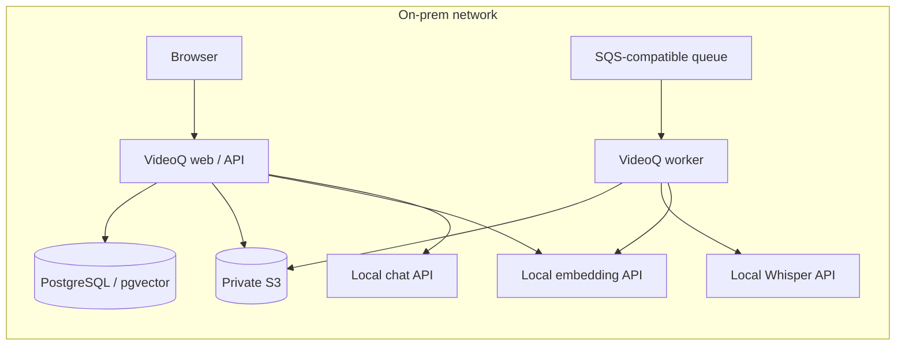

# Local inference for VideoQ

This optional chart installs selectable private LLM / embedding servers and
whisper.cpp (CPU) / vLLM (NVIDIA or AMD) speech services. llama.cpp is the CPU default; vLLM supports NVIDIA CUDA and AMD ROCm GPU profiles. Install it separately from the application chart so
model caches, GPU scheduling and application upgrades have separate lifecycles.
The application chart's default still uses hosted OpenAI; explicitly apply its
`examples/local-ai-llamacpp.yaml` or `examples/local-ai-vllm.yaml` overlay to select these services.

Mac development runs whisper.cpp natively with Metal, outside this Linux
Kubernetes chart. Both speech engines use the application's `local` backend;
see the [Mac setup and common API contract](../../docs/guides/local-inference.md#mac-development-with-whispercpp).

## Placement and capabilities



CPU defaults use Qwen3-4B Q4_K_M chat, gte-Qwen2-1.5B Q4_K_M embeddings
(native 1536 dimensions) and
whisper.cpp with multilingual quantized `ggml-large-v3-turbo-q5_0.bin`. These are starting points for a small acceptance
test. Measure production model quality, throughput, RAM and GPU VRAM with the
site's Japanese videos. The CPU overlay disables visual inspection because its
chat model accepts text only. Transcription, subtitle search, cited Q&A and
timestamp playback remain available. To enable visual inspection, provision a
local vision model supporting images, tool calls and strict JSON Schema,
validate it, and change both charts' chat model plus `config.videoVisualEnabled`.

The site provides PostgreSQL/pgvector, S3 and a persistent SQS-compatible queue
as described in the application chart. No Cloudflare, Modal or OpenAI account
is required for this local configuration. Initial image/model downloads use the
internet. During processing, video, audio, prompts and embeddings stay on the
configured site services.

## Select roles and environments

The application uses independent OpenAI-compatible endpoints for chat,
embeddings and speech. The inference chart is optional: deploy only roles that
VideoQ should operate, and point the other application endpoints at existing
services. Disabling a role does not choose or start a replacement automatically.

| Environment | Inference profile | Notes |
| --- | --- | --- |
| Linux amd64 CPU | defaults / `examples/llamacpp-cpu.yaml` | Upstream llama.cpp and whisper.cpp images |
| Linux arm64 CPU | `examples/cpu-arm64.yaml` | Upstream multiarch llama.cpp and separate arm64 whisper.cpp image |
| Native Apple Silicon | Homebrew recipes in the [local guide](../../docs/guides/local-inference.md) | Native Metal; not the Linux CPU container profile |
| NVIDIA CUDA | `examples/vllm-nvidia.yaml` | GPU hardware/model acceptance required |
| AMD ROCm | `examples/vllm-amd.yaml` | GPU hardware/model acceptance required; offline speech codec payload |
| Different engines per role | `examples/mixed-engines.yaml` | CUDA chat, CPU embedding, ROCm speech |
| Existing chat/embedding services | `examples/speech-only-cpu.yaml` | Only speech is deployed by this release |
| All services already operated | Do not install this chart, or disable all roles | Configure the application endpoints directly |

`servers.chat.enabled`, `servers.embedding.enabled` and `whisper.enabled` default
to true. A disabled role creates no Deployment, Service or cache PVC. Existing
PVCs keep their retention policy; disabling a role is not a data deletion.
NetworkPolicy ports follow the enabled roles. With all roles disabled the chart
renders no resources and does not demand unused image digests or GPU allocations.

For enabled chat/embedding roles, set `backend` to `llamacpp` or `vllm` and
`accelerator` to `nvidia` or `amd` when using vLLM. Empty values inherit the
chart-level `backend` and `vllm.accelerator`. `whisper.backend` remains explicit;
`whisper.accelerator` can override the GPU default independently. Each GPU role
selects the matching unmodified upstream CUDA/ROCm image and validates its own
resource vendor. Keep the model format and GPU resource map consistent with
each role; switching an engine does not convert weights or clear Helm-merged
resource keys. `examples/mixed-engines.yaml` is a standalone example with valid
per-role model/resource settings, not an overlay to stack on another full GPU
profile. Use the `local-ai-llamacpp` application overlay with that example's CPU
embedding alias, set `ai.whisperChunkSeconds: 300`, and select application
`ai.separateToolSchema` according to the chat runtime's accepted behavior.

`servers.<role>.extraArgs` and `whisper.extraArgs` pass site-selected flags to
the upstream processes. Avoid duplicating required model, address or protocol
flags. Repository/digest fields and `imagePullSecrets` remain configurable for
reviewed private mirrors; no model/runtime is automatically downloaded or built
during serving.

The pinned ROCm speech image uses `whisper.audioCodecs: auto` to stage the locked
codec payload. Set `upstream` to omit this initializer/mount only after a newer
or site-operated upstream image passes the actual WAV decoding check on its own.
Set `bundled` to request the reviewed CPython 3.12 payload explicitly for a vLLM
speech image. This makes the workaround removable without changing the chart's
engine code. Never copy CPU PyTorch or NumPy into a GPU image.

## Choose an inference engine

| Recipe | Inference values | Application values | Model placement |
|---|---|---|---|
| llama.cpp CPU | defaults or `examples/llamacpp-cpu.yaml` | `charts/videoq/examples/local-ai-llamacpp.yaml` | Separate CPU chat and embedding Pods; Whisper CPU |
| vLLM NVIDIA | `examples/vllm-nvidia.yaml` | `charts/videoq/examples/local-ai-vllm.yaml` | Three CUDA GPUs, one each for chat, embedding and Whisper |
| vLLM AMD | `examples/vllm-amd.yaml` | `charts/videoq/examples/local-ai-vllm.yaml` | Three ROCm GPUs, one each for chat, embedding and Whisper; hardware acceptance pending |

The application connects to OpenAI-compatible Chat Completions and embeddings.
Private llama.cpp and vLLM servers use the same protocol as hosted OpenAI.
`EMBEDDING_BASE_URL` selects the embedding endpoint. `ai.embeddingBaseUrl` / `EMBEDDING_BASE_URL` is independent of
`ai.openaiBaseUrl` / `OPENAI_BASE_URL`. An empty embedding URL uses the configured
chat base URL. Optional `EMBEDDING_API_KEY` in the runtime Secret
selects a separate embedding credential; otherwise `OPENAI_API_KEY` is reused.
For the private unauthenticated recipes, use `local-inference` placeholders.
Authentication for existing protected inference services is configured by the
site; these recipe services rely on private ClusterIP and NetworkPolicy.

The same app configuration can point to separately operated compatible servers,
including different chat and embedding runtimes. The chart-level `backend` supplies the default; `servers.chat.backend` and
`servers.embedding.backend` can select each runtime independently. Empty role
settings inherit the chart defaults. Model templates, tool parsers and JSON Schema
behavior must pass the common acceptance suite; API compatibility alone does not
establish VideoQ compatibility. The tested Qwen3/llama.cpp recipe requires
`separateToolSchema=true`. The vLLM recipe starts with
native tools plus schema enforcement and requires GPU acceptance.

The llama.cpp recipe uses pinned Qwen3-4B Q4_K_M chat weights and a pinned
`second-state/gte-Qwen2-1.5B-instruct-GGUF` Q4_K_M embedding conversion. Review the
conversion publisher and SHA256 before site acceptance. That embedding model
natively returns 1536 dimensions. The pinned llama.cpp server does not reduce
Qwen3-Embedding-4B's 2560 dimensions through the request's `dimensions` field;
VideoQ rejects that mismatch, without truncation or padding. vLLM uses Qwen3-4B
and Qwen3-Embedding-4B safetensors, explicitly permitting the latter's trained
Matryoshka output at 1536 dimensions. See [llama.cpp server](https://github.com/ggml-org/llama.cpp/blob/master/tools/server/README.md)
and [vLLM embedding configuration](https://docs.vllm.ai/en/latest/models/pooling_models/embed/#matryoshka-embeddings).

**Rebuild all scene embeddings before searching when changing embedding weights,
quantization, pooling or preprocessing**, even if both configurations return
1536 dimensions. Each profile uses a distinct embedding model alias. API and
worker must receive the same alias and endpoint. When replacing weights, change
both `servers.embedding.servedModel` and `ai.embeddingModel` rather than reusing
an old alias. The existing database does not automatically migrate vector spaces.

## Install llama.cpp or vLLM

Download and verify a [signed public release](../../docs/guides/on-premises-releases.md)
first. It includes both chart archives and generates `verified-images.json` for
the app and `verified-inference.json` for inference. The CPU gateway supports
amd64/arm64; CUDA/ROCm GPU profiles use upstream vLLM images on amd64. No site image build
or GHCR pull authentication is required. Chat and embedding init containers
reuse the gateway image's locked Hugging Face downloader.
GGUF downloads use exact revisions and SHA256; safetensors snapshots use exact
revisions and exclude pickle weights and Python code. Serving Pods mount weights
read-only and run offline. Cached complete models skip network downloads.

Choose one inference/application pair from the table, for example:

```sh
helm upgrade --install inference /secure/videoq-release/videoq-inference-0.1.0-sha.$SOURCE_SHA.tgz \
  --namespace videoq --create-namespace \
  -f charts/videoq-inference/examples/llamacpp-cpu.yaml \
  -f /secure/inference-site.yaml -f /secure/videoq-release/verified-inference.json \
  --wait --timeout 30m
helm upgrade --install videoq /secure/videoq-release/videoq-0.1.0-sha.$SOURCE_SHA.tgz \
  --namespace videoq -f /secure/site.yaml \
  -f charts/videoq/examples/local-ai-llamacpp.yaml \
  -f /secure/videoq-release/verified-images.json --wait --timeout 15m
```

For vLLM choose `vllm-nvidia.yaml` (CUDA) or `vllm-amd.yaml` (ROCm), and use
`local-ai-vllm.yaml` for the application. Install the matching vendor device
plugin and review GPU memory first. Both full profiles reserve **three allocatable
GPUs** without sharing: chat, embedding and Whisper. Resource limits are starting
values, not measured production sizing. GPU execution and driver compatibility
require actual site acceptance; CPU/model-independent checks do not validate them.
The chart pins separate official CUDA and ROCm images. They are pulled directly,
not rebuilt or republished by VideoQ. Review the scan for the selected image;
the existing NVIDIA kernel-header assessment does not apply to AMD images.

These profiles serve `videoq-inference-chat:8000`,
`videoq-inference-embedding:8000` and `videoq-inference-whisper:8080`.
Use `downloadModels=false` and `networkPolicy.denyEgress=true` after provisioning,
retaining the selected engine profile on every Helm upgrade. Changing `backend`
replaces Deployments; it does not convert PVC contents. Back up old caches and
adopt existing compatible claims explicitly. PVCs use a keep policy.

## AMD ROCm deployment

Use `examples/vllm-amd.yaml` with the same application overlay as the CUDA profile:

```sh
helm upgrade --install inference /secure/videoq-release/videoq-inference-0.1.0-sha.$SOURCE_SHA.tgz \
  --namespace videoq --create-namespace \
  -f charts/videoq-inference/examples/vllm-amd.yaml \
  -f /secure/inference-site.yaml -f /secure/videoq-release/verified-inference.json \
  --wait --timeout 30m
```

The profile selects `vllm.accelerator: amd`, the digest-pinned official
`vllm.rocmImage` (`vllm/vllm-openai-rocm:v0.32.0`), and `amd.com/gpu` requests and
limits. The resource checks reject the other vendor's GPUs and mismatched
requests/limits. Speech requires exactly one GPU; chat and embedding require at
least one each. CPU backends must not reserve either vendor's GPUs.

For **only one speech GPU**, keep CPU chat/embeddings and use
`examples/whisper-amd.yaml` with `charts/videoq/examples/local-ai-llamacpp.yaml`.
Set application `ai.whisperChunkSeconds: 300` to match the GPU speech recipe.
Do not combine the full NVIDIA and AMD overlays: Helm merges resource maps and
the remaining other-vendor requests intentionally fail validation.

The site must provide Linux amd64 nodes, a supported AMD GPU/driver/ROCm
combination, and the [AMD device plugin or GPU Operator](https://github.com/ROCm/k8s-device-plugin).
The plugin exposes `amd.com/gpu` and injects the GPU devices; these charts do not
mount arbitrary host device directories or enable privileged containers.
Consult the [versioned vLLM ROCm requirements](https://github.com/vllm-project/vllm/blob/v0.32.0/docs/getting_started/installation/gpu.rocm.inc.md)
for GPU architectures and feature limits. A family listed by upstream does not
establish acceptance for VideoQ's Qwen3 chat, embedding and Whisper combination.
The exact GPU is not yet selected; no AMD GPU inference has been validated here.

The pinned ROCm v0.32.0 image omits the audio decoders needed by the transcription
endpoint. For AMD speech, a `provision-audio` init container copies the gateway's
locked upstream `soundfile`/CFFI runtime packages into an `emptyDir`, mounted
read-only at `/audio-deps` by the engine. It does not copy CPU PyTorch or NumPy,
rebuild vLLM, run pip, or access the network. The two images use the reviewed
CPython 3.12 ABI; CI tests this exact codec payload in the ROCm image. This local
initializer remains when `downloadModels=false`; all model downloaders are still
removed. Chat/embedding Pods and CUDA speech do not mount this payload. When an
upstream ROCm release passes the WAV check without it, remove the extra payload.

Pods run as UID/GID 10001 with the existing restricted container security
context. If your device runtime does not assign accessible ownership to allocated
devices, add the **actual host** render/video group IDs to the site values:

```yaml
vllm:
  supplementalGroups: [44, 109] # Examples only; replace with your node group IDs.
```

Obtain the group IDs from the AMD nodes (for example, `stat -c '%g' /dev/kfd
/dev/dri/renderD*`) and make them consistent across the scheduled nodes. Keep
runtime security settings restricted unless the installed driver's documented
requirements and site policy justify a reviewed change. Performance flags,
attention kernels and memory sizing depend on the chosen GPU; no architecture
spoofing or experimental kernel override is enabled by this profile.

After the model Pods are ready, verify each actual allocation. The script checks
ROCm PyTorch, an available GPU and a small FP16 matrix multiplication, failing
instead of falling back to CPU:

```sh
kubectl -n videoq exec -i deployment/videoq-inference-chat -c chat -- \
  python3 - amd < apps/inference/vllm/check_gpu_runtime.py
kubectl -n videoq exec -i deployment/videoq-inference-embedding -c embedding -- \
  python3 - amd < apps/inference/vllm/check_gpu_runtime.py
kubectl -n videoq exec -i deployment/videoq-inference-whisper -c engine -- \
  python3 - amd < apps/inference/vllm/check_gpu_runtime.py
```

This allocation check is only the first hardware check. Acceptance must also
exercise Qwen3 tool calls and strict JSON Schema, 1536-dimensional embedding
output and matching indexing/query vectors, Japanese Whisper timestamps and
silence, plus a complete upload/index/cited-answer/playback flow with public
egress blocked. CI checks both upstream images' WAV decoding and vulnerabilities
without a GPU, including the locked codec payload for ROCm speech; it is not GPU model-execution evidence. AMD scans do not reuse the
NVIDIA-only vulnerability assessment.

## Site settings and optional private rebuilds

Keep an operator-owned `/secure/inference-site.yaml` outside the repository:

```yaml
networkPolicy:
  clientNamespace: videoq
  clientRelease: videoq
```

The release verifier supplies `whisper.image` as an immutable public image
reference and requires image digests. The signed chart pins the upstream
llama.cpp, whisper.cpp and CUDA/ROCm vLLM images. Never replace reviewed
image values with a tag. If a site needs a private rebuild, build
`apps/inference/whisper/Dockerfile` (amd64/arm64 gateway),
retain the same license, scan/SBOM and provenance controls, and use an explicitly
reviewed site-owned image values file instead of the public image values.

Use that file with the selected inference/application pair above. The overlay
assumes namespace `videoq`; update the service URLs if changing namespace,
service names or cluster DNS suffix. Match `networkPolicy.clientRelease` to the
application Helm release. Set `OPENAI_API_KEY=local-inference` in its Secret
(and optionally `EMBEDDING_API_KEY`); keep the other runtime credentials from the
application guide. Secret environment variables can override ConfigMap endpoints.

## Restrict processing to the site

Whisper always loads local files, sets `HF_HUB_OFFLINE=1`, and mounts runtime
weights read-only. Its API accepts only `whisper-local` and exposes no model
management. Failures stay local; there is no automatic hosted fallback.

The llama.cpp app overlay sets `ai.reasoningEffort: none` and
`ai.separateToolSchema: true`. The latter separates tool decisions from the
final-answer grammar. When
no more tools are requested, the adapter makes a native JSON Schema call from
the original messages and retrieved evidence. An intermediate draft is discarded
and never streamed or used as conversion input. This adds one final model call;
hosted defaults keep their existing flow. Acceptance includes the production
streaming RAG agent with real inference and fixed retrieval evidence.

CPU inference can take several minutes per agent answer. The local overlay sets
both request deadlines to 600000 ms (ten minutes); set the site's ingress and
client timeouts accordingly. The default hosted deadlines remain unchanged.
GPU deployments can reduce these values after measuring their latency.

The application overlay creates an egress NetworkPolicy allowing its own
namespace and cluster DNS. Add infrastructure namespaces or exact intranet CIDRs
when DB, S3, queues or inference run elsewhere:

```yaml
networkPolicy:
  localEgressOnly: true
  allowedNamespaces: [videoq-data]
  allowedCIDRs: [10.40.20.0/24]
```

The CNI must enforce NetworkPolicy. Policies are additive: remove any other
policy that permits broader egress. Verify from an application Pod that site
services work and public HTTPS is blocked. Add the node-local DNS IP explicitly
if the cluster uses NodeLocal DNS. See
[Kubernetes NetworkPolicy](https://kubernetes.io/docs/concepts/services-networking/network-policies/).
After provisioning, remove downloaders and deny inference egress:

```sh
helm upgrade inference charts/videoq-inference --namespace videoq \
  -f /secure/inference-site.yaml --set downloadModels=false \
  --set networkPolicy.denyEgress=true --wait --timeout 15m
```

Persist these settings in the operator values for future upgrades. Missing
weights fail startup or keep inference Pods unready. Nodes can still pull container images before Pod
startup. The on-prem application edition disables external mail, Google OAuth, Stripe
and YouTube/SearchAPI. This recipe handles uploaded videos and administrator-issued
local accounts; it does not change an explicitly selected inference endpoint.

## NVIDIA Whisper engine

The complete `vllm-nvidia.yaml` profile selects vLLM for speech as well as chat
and embeddings. To add only a speech GPU to a CPU chat/embedding installation,
apply `examples/whisper-nvidia.yaml` and set the application's
`ai.whisperChunkSeconds: 300`. Each model has its own process and dedicated GPU.

Use the official `vllm/vllm-openai` image pinned in `vllm.image` for all three
model roles. No VideoQ vLLM image is built or republished. For an offline site,
mirror that exact image digest to the site's registry and override `vllm.image` (CUDA) or `vllm.rocmImage` (ROCm).
Preserve the pinned version and verify the mirror's content before deployment.

The profile provisions
`openai/whisper-large-v3-turbo` at an immutable revision before serving; runtime
uses that local directory. Initial L4 validation used 70% GPU-memory reservation
and eight active sequences. This is not a measured minimum VRAM requirement.
Validate the site's driver, GPU capacity and recognition quality before rollout.

## Speech preprocessing and batching

Both profiles expose the same private gateway on port 8080 and the app uses
`WHISPER_BACKEND=local`, `whisper-local`, `verbose_json`, and segment timestamps.
The engine listens only on loopback port 8081, including its model-management
routes. Only the gateway has a Service. It normalizes audio levels, uses bundled
Silero ONNX VAD, merges only overlapping VAD padding, keeps spans within 30 seconds, and restores original
source offsets after recognition. Silent input returns no captions. Text without
real timestamps is rejected rather than converted into a fabricated subtitle.
Requests cannot change weights, command arguments, or inference URLs.

`whisper.upstreamParallelism` is 1 for CPU and 4 for GPU profiles.
`whisper.maxConcurrentRequests` bounds uploads and active video requests (CPU 1,
GPU 2); excess traffic receives retryable 503 responses.
`whisper.maxSequences: 8` configures vLLM's dynamic batching across those speech
requests. It does not wait for eight videos to arrive. The previous faster-whisper
batch-size/device/compute-type fields are removed and rejected by the schema.

The CPU application profile uses 30-second durable checkpoints; GPU and cloud
use 300 seconds. `ai.whisperChunkSeconds` / `WHISPER_CHUNK_SECONDS` accepts 30–300
seconds. Short CPU checkpoints keep individual calls within the worker's
120-second inference deadline without extending queue leases. Completed results
are reused after retries and their offsets remain relative to the source video.
Existing plans keep their recorded interval size. Drain incomplete plans on
the previous release before changing runtimes or CPU/GPU profiles; a retry
does not resize an existing plan. No retired-provider fallback is retained.
The serial on-prem poller defaults to one message at a time. Measure service
capacity before increasing worker replicas or admission limits.

CPU's quantized multilingual small model is a small acceptance baseline, not a promise of
Japanese recognition accuracy. Larger checkpoints need more CPU/RAM and may need
shorter worker intervals. Review weights, checksums, source coverage, silence,
Japanese accuracy and throughput with representative site recordings.

## Configuration contract

Install using the selected engine profile and a current operator values file.
Only the documented fields are accepted; unknown chart options fail validation.
Chat and embedding endpoints/models must match the application profile. There
is no provider selector: the embeddings protocol is OpenAI-compatible.

## Acceptance checks

The `Local Inference Basic Checks` Actions workflow runs on standard
`ubuntu-24.04`, `ubuntu-24.04-arm` and `macos-15` runners. Related PR/push changes
select it through CI; it can also be started manually and runs weekly. It checks
chart variants, application/worker API contracts, and native server CLI startup.
Linux uses the chart's digest-pinned upstream images with networking disabled
for CLI execution; macOS uses Homebrew bottles and records installed versions.
It downloads no model weights and does not establish model quality, GPU/Metal
inference or complete application acceptance. Reports are retained for seven days
as `local-inference-basic-<runner>` artifacts. The existing real CPU lifecycle
workflow remains separate. Manual `On-prem Validation` runs also call these
basic checks; set `basic_only=true` there to run only the native matrix on a
feature branch. No paid or self-hosted runner is selected by the basic
workflow in `.github/workflows/local-inference-basic.yml`.


From a reviewed checkout with npm dependencies, uv and FFmpeg installed,
port-forward the private services in separate terminals:

```sh
kubectl -n videoq port-forward service/videoq-inference-chat 11436:8000
kubectl -n videoq port-forward service/videoq-inference-embedding 11437:8000
kubectl -n videoq port-forward service/videoq-inference-whisper 18085:8080
```

Never expose these ports publicly. Use a short, nonsensitive speech video.
 Set the
embedding alias for the chosen recipe (`qwen3-embedding-4b-5cf2132a` for vLLM).
For vLLM start with `LOCAL_AI_TEST_SEPARATE_TOOL_SCHEMA=false`, matching its app profile:

```sh
LOCAL_AI_TEST_CHAT_BASE_URL=http://127.0.0.1:11436/v1 \
LOCAL_AI_TEST_EMBEDDING_BASE_URL=http://127.0.0.1:11437/v1 \
LOCAL_AI_TEST_MODEL=videoq-chat \
LOCAL_AI_TEST_SEPARATE_TOOL_SCHEMA=true \
LOCAL_AI_TEST_EMBEDDING_MODEL=gte-qwen2-1.5b-q4km-124fbdad \
LOCAL_AI_TEST_WORKER_PYTHON="$PWD/apps/worker/.venv/bin/python" \
  npm run test:unit --workspace @videoq/api -- test/local-inference.integration.test.ts
WHISPER_BACKEND=local WHISPER_LOCAL_URL=http://127.0.0.1:18085/v1 \
EMBEDDING_BASE_URL=http://127.0.0.1:11437/v1 \
EMBEDDING_MODEL=gte-qwen2-1.5b-q4km-124fbdad EMBEDDING_API_KEY=local-inference \
  uv run --project apps/worker --locked python \
  apps/worker/scripts/check_local_inference.py /secure/test.mp4 --seconds 30
```

The same suite checks native structured answers, tools, streaming, cited RAG and
1536-dimensional embeddings. With `LOCAL_AI_TEST_WORKER_PYTHON` it also compares
TypeScript query embeddings to a real Python indexing batch. The RAG test uses
fixed retrieval evidence, not a live database or browser. On 2026-10-27 all six
checks passed against the pinned Linux amd64 CPU llama.cpp/model defaults with
`LOCAL_AI_TEST_SEPARATE_TOOL_SCHEMA=true`, including the Python worker comparison
(cosine similarity greater than 0.999). Serving public TCP egress was blocked.
This result does not establish GPU, ARM, native macOS or full application acceptance.
Exact arguments, model identities and assertion results are in the [audit record](https://github.com/yukiharada1228/videoq/blob/0b137cfc/docs/verification/upstream-package-audit-2026-10-26.json).
Optional protected
services use `LOCAL_AI_TEST_API_KEY` / `LOCAL_AI_TEST_EMBEDDING_API_KEY`.
`LOCAL_AI_TEST_SEPARATE_TOOL_SCHEMA=true` is available when a particular
model/server needs the two-call workaround; record that choice in app values.
Finish with upload → transcription → indexing → cited Q&A → timestamp playback
through the UI with public egress blocked. The complete CPU lifecycle harness
(`.github/scripts/onprem-cpu-acceptance.py`) requires at least 10 GiB of Docker
memory before provisioning models or a cluster. This floor covers the complete
test fixture; it is not a production sizing or throughput guarantee. For local
runs, keep evidence and weights under an ignored persistent directory such as
`.local-models/verification/`, since `/tmp` may disappear after a host restart. Record model/image digests and site
quality/throughput results. The worker check does not write to the DB.
Uninstall inference separately from the app; PVCs are retained. Adopt compatible
claims through `persistence.existingClaim` on reinstall.

The NVIDIA vLLM scan uses a narrowly scoped kernel-header [OpenVEX assessment](../../apps/inference/vllm/security/README.md). Preserve the JSON scan report, including suppressed findings, with the reviewed image digest. A passing assessed gate would not establish the site host kernel's patch status.

The 2026-10-26 package scans passed llama.cpp on amd64/arm64, and the
transcription gateway and worker on amd64. Additional 2026-10-27 builds of the
API and web images also passed on amd64, with a successful isolated API HTTP/DB
smoke test. The pinned CUDA vLLM image still has 21 HIGH/CRITICAL findings after its
existing assessment; ROCm has 803 without exemptions. Those vLLM release gates
remain failing. CPU whisper.cpp originally reported 534 findings per architecture,
all in `linux-libc-dev`. On 2026-10-27, a separate package-specific assessment
passed for both images after verifying their complete flattened filesystems.
See the [audit record](https://github.com/yukiharada1228/videoq/blob/0b137cfc/docs/verification/upstream-package-audit-2026-10-26.json)
for image identities, package findings, scanner/database versions and scope.
The tested 2026-10-26 official nightly candidates also failed: CUDA had 18 and
ROCm had 12 findings outside `linux-libc-dev`. Neither candidate was promoted;
the stable image pins remain in place. This does not evaluate every variant.
CI scans each CPU engine for both Linux amd64 and arm64 independently, selects
the registry manifest explicitly and checks the report architecture/digest.
Architecture-specific reports are retained even when the vulnerability gate fails.
These package scans do not execute ARM inference.

The [CPU whisper.cpp assessment](../../apps/inference/whispercpp/security/kernel-headers.openvex.json)
is independent of NVIDIA's assessment. It covers only its explicit 534 CVE IDs
on Ubuntu 22.04 `linux-libc-dev` 5.15.0-198.208, separately for amd64 and arm64.
The [image inventories](../../apps/inference/whispercpp/security/header-image-inventory.json)
pin both image digests, package versions and hashes of every owned header/doc file.
CI uses `docker export` without running image binaries or extracting paths on the
host, checks that kernel binaries/modules are absent, and rejects a changed
inventory before applying VEX. The amd64 image owns 962 header/documentation
files; arm64 owns 935. No engine image is rebuilt or modified. The scan reports
retain the 534 assessed findings on each architecture; a passing assessed gate
does not mean zero raw findings or establish the host kernel's patch status.
This follows the [Trivy maintainers' explanation of source-package detection](https://github.com/aquasecurity/trivy/discussions/6562);
the actual host kernel must be reviewed separately against
[Ubuntu kernel advisories](https://ubuntu.com/security/CVE-2023-53867).

## Upstream image policy and package names

Use upstream inference images directly whenever they meet the runtime and
security requirements. llama.cpp and CPU whisper.cpp run in upstream containers;
VideoQ does not compile either engine. The transcription gateway contains only
VideoQ's audio preprocessing, VAD, subtitle API and model provisioner.

The [official whisper.cpp publisher](https://github.com/ggml-org/whisper.cpp/blob/master/.github/workflows/docker.yml) uses separate amd64 (`main`) and arm64
(`main-arm64`) images. Both are pinned by digest in `values.yaml`; the default
CPU speech architecture is amd64. For an arm64 speech node set:

```yaml
whispercpp:
  architecture: arm64
```

The chart sets the matching node architecture and rejects a conflicting
`whisper.nodeSelector`. Mirror both reviewed image digests when provisioning
an offline registry. The upstream entrypoint is overridden to invoke
`/app/build/bin/whisper-server` directly, with the engine on loopback.

vLLM also runs directly from its official `vllm/vllm-openai` (CUDA) or
`vllm/vllm-openai-rocm` (ROCm) image, pinned by digest. Chat, embeddings and speech use the same upstream image in independent
Pods. CI tests the gateway's 16 kHz mono WAV decoding path, using the offline
locked codec payload for ROCm speech. The NVIDIA check also verifies the scoped
kernel-header inventory. Both upstream images remain unmodified and are scanned;
codec packages are covered by the gateway image scan. Scan failures require a reviewed upstream update;
they do not trigger local package patching or a weaker vulnerability gate.

New releases publish `videoq-api`, `videoq-web`, `videoq-worker`,
and `videoq-transcription-gateway`; the `videoq-onprem-*` names
belong to previous releases. Keep old releases and their signed manifests intact
for rollback. Upgrade using the matching new chart and verified image values;
replace any site-owned `whisper.vllmImage` override with `vllm.image` (CUDA) or `vllm.rocmImage` (ROCm).
