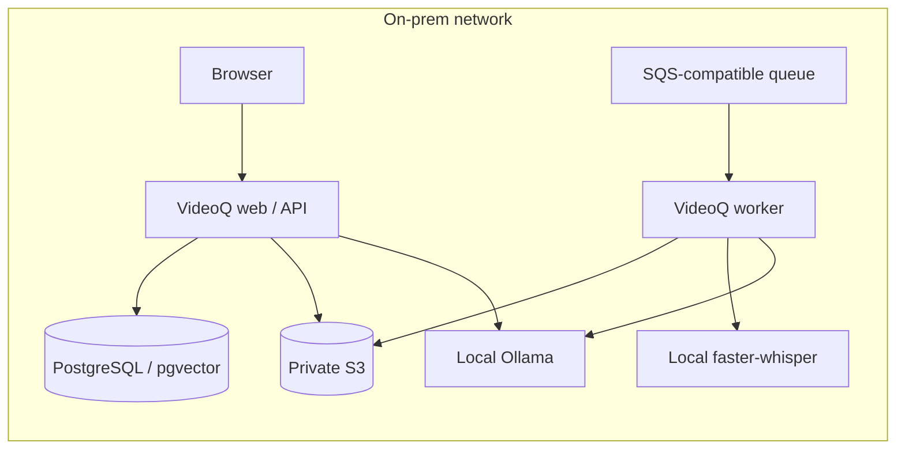

# Local inference for VideoQ

This optional chart installs private Ollama (chat and embeddings) and
faster-whisper services. Install it separately from the application chart so
model caches, GPU scheduling and application upgrades have separate lifecycles.
The application chart's default still uses hosted OpenAI; explicitly apply its
`examples/local-ai.yaml` overlay to select these services.

## Placement and capabilities



CPU defaults use `qwen3:4b`, `qwen3-embedding:4b` (1536 output dimensions) and
`Systran/faster-whisper-base`. These are starting points for a small acceptance
test. Measure production model quality, throughput, RAM and GPU VRAM with the
site's Japanese videos. The CPU overlay disables visual inspection because its
chat model accepts text only. Transcription, subtitle search, cited Q&A and
timestamp playback remain available. To enable visual inspection, provision a
local vision model supporting images, tool calls and strict JSON Schema,
validate it, and change both charts' chat model plus `config.videoVisualEnabled`.

The site provides PostgreSQL/pgvector, S3 and a persistent SQS-compatible queue
as described in the application chart. No Cloudflare, Modal or OpenAI account
is required for this local configuration. Initial image/model downloads use the
internet. During processing, video, audio, prompts and embeddings stay on the
configured site services.

## Build and install on CPU

Build and push Whisper to a private registry readable by the Kubernetes nodes.
Select the nodes' platform; the CPU image supports amd64 and arm64.

```sh
docker build --platform linux/amd64 \
  -t registry.intranet/videoq-whisper:0.1.0-cpu apps/inference/whisper
docker push registry.intranet/videoq-whisper:0.1.0-cpu
docker buildx imagetools inspect registry.intranet/videoq-whisper:0.1.0-cpu
```

Record the immutable digest. This site-built Whisper image is **not** part of
the existing three-image signed GHCR release. Base images and Python
dependencies are pinned; `uv.lock` also locks CUDA extras. Weights live on PVCs.
Create an operator-owned values file outside the repository:

```yaml
requireImageDigests: true
whisper:
  image:
    repository: registry.intranet/videoq-whisper
    digest: sha256:REPLACE_WITH_REVIEWED_DIGEST
networkPolicy:
  clientNamespace: videoq
  clientRelease: videoq
```

```sh
helm lint charts/videoq-inference --strict -f /secure/inference-site.yaml
helm upgrade --install inference charts/videoq-inference \
  --namespace videoq --create-namespace -f /secure/inference-site.yaml \
  --wait --timeout 30m
```

Services are `videoq-inference-ollama:11434` and
`videoq-inference-whisper:8080`, both ClusterIP only. Init containers download
weights before requests can reach inference. Cached restarts skip downloads.
Whisper uses an exact Hugging Face commit in a revision-specific directory.
Ollama tags are cached without automatic refresh: record full digests from
`/api/tags` at acceptance and back up both claims. Change to a reviewed new tag
or explicitly provision a new cache before acceptance and reindexing.

Set `OPENAI_API_KEY=local-inference` in the application's runtime Secret. This
is a nonsecret SDK placeholder; no hosted OpenAI key is needed. Keep database,
storage, queue and encryption credentials from the application guide. Put only
documented credentials in the Secret: its environment variables can override
the ConfigMap's inference endpoints.

```sh
helm upgrade --install videoq charts/videoq --namespace videoq \
  -f /secure/site.yaml -f /secure/verified-images.json \
  -f charts/videoq/examples/local-ai.yaml --wait --timeout 15m
```

The overlay assumes namespace `videoq`. If changing namespace, service names or
cluster DNS suffix, update all three inference URLs. If changing the application
release name, update the inference chart's client release selector too.

## Restrict processing to the site

Ollama sets `OLLAMA_NO_CLOUD=1`; see its
[local-only configuration](https://docs.ollama.com/faq#how-do-i-disable-ollamas-cloud-features).
Whisper always loads local files, sets `HF_HUB_OFFLINE=1`, and mounts runtime
weights read-only. Its API accepts only `whisper-local` and exposes no model
management. Failures stay local; there is no automatic hosted fallback.

The app overlay sets `ai.reasoningEffort: none` and `ai.separateToolSchema: true`.
The latter lets Ollama decide tool calls without the final-answer grammar. When
no more tools are requested, the adapter makes a native JSON Schema call from
the original messages and retrieved evidence. An intermediate draft is discarded
and never streamed or used as conversion input. This adds one final model call;
hosted defaults keep their existing flow. Acceptance includes the production
streaming RAG agent with real inference and fixed retrieval evidence.

CPU inference can take several minutes per agent answer. The local overlay sets
both request deadlines to 600000 ms (ten minutes); set the site's ingress and
client timeouts accordingly. The default hosted deadlines remain unchanged.
GPU deployments can reduce these values after measuring their latency.

The application overlay creates an egress NetworkPolicy allowing its own
namespace and cluster DNS. Add infrastructure namespaces or exact intranet CIDRs
when DB, S3, queues or inference run elsewhere:

```yaml
networkPolicy:
  localEgressOnly: true
  allowedNamespaces: [videoq-data]
  allowedCIDRs: [10.40.20.0/24]
```

The CNI must enforce NetworkPolicy. Policies are additive: remove any other
policy that permits broader egress. Verify from an application Pod that site
services work and public HTTPS is blocked. Add the node-local DNS IP explicitly
if the cluster uses NodeLocal DNS. See
[Kubernetes NetworkPolicy](https://kubernetes.io/docs/concepts/services-networking/network-policies/).
After provisioning, remove downloaders and deny inference egress:

```sh
helm upgrade inference charts/videoq-inference --namespace videoq \
  -f /secure/inference-site.yaml --set downloadModels=false \
  --set networkPolicy.denyEgress=true --wait --timeout 15m
```

Persist these settings in the operator values for future upgrades. Missing
weights fail Whisper startup or keep Ollama unready. Nodes can still pull container images before Pod
startup. External email, Google OAuth, Stripe and YouTube/SearchAPI need
separate site decisions; this recipe covers uploaded videos and email/password
sign-in. Omit hosted credentials for features that must remain disconnected.

## NVIDIA GPU option

Install NVIDIA drivers, container runtime integration and the Kubernetes device
plugin. Build on linux/amd64 with the locked CUDA extra:

```sh
docker build --platform linux/amd64 --build-arg INFERENCE_DEVICE=cuda \
  -t registry.intranet/videoq-whisper:0.1.0-cuda apps/inference/whisper
docker push registry.intranet/videoq-whisper:0.1.0-cuda
helm upgrade --install inference charts/videoq-inference --namespace videoq \
  -f charts/videoq-inference/examples/nvidia.yaml \
  -f /secure/inference-gpu-site.yaml --wait --timeout 30m
```

The GPU site file must select the CUDA image's digest. This profile uses Whisper
large-v3 and requests one GPU per Deployment: **two allocatable GPUs** in total,
possibly on separate nodes. It configures no GPU sharing. A single-GPU site can
keep Ollama on CPU and apply only the Whisper portion, or the reverse. GPU
drivers, VRAM, scheduling, concurrent throughput and large-v3 inference require
acceptance on actual hardware; CPU results do not establish GPU readiness.

## Acceptance checks

From a reviewed checkout with npm dependencies, uv and FFmpeg installed, expose
the services temporarily via two local port-forwards. Never expose them publicly.

```sh
kubectl -n videoq port-forward service/videoq-inference-ollama 11435:11434
kubectl -n videoq port-forward service/videoq-inference-whisper 18085:8080
```

In another terminal, use a short, nonsensitive video with audible speech:

```sh
LOCAL_AI_TEST_URL=http://127.0.0.1:11435 \
  npm run test:unit --workspace @videoq/api -- test/local-inference.integration.test.ts
WHISPER_BACKEND=local WHISPER_LOCAL_URL=http://127.0.0.1:18085/v1 \
  EMBEDDING_PROVIDER=ollama EMBEDDING_MODEL=qwen3-embedding:4b \
  OLLAMA_BASE_URL=http://127.0.0.1:11435 \
  uv run --project apps/worker --locked python \
  apps/worker/scripts/check_local_inference.py /secure/test.mp4 --seconds 30
```

The API suite tests real structured answers with numeric citations, SSE, tool
calls and query vectors. The worker checks extraction, timestamped transcription
and indexing vectors without database writes. Then test upload → transcript →
indexing → cited Q&A → timestamp playback through the UI with public egress
blocked. Record model/image digests and acceptance results. API and worker must
use the same embedding model and 1536 dimensions. Changing from OpenAI to Qwen
requires rebuilding existing scene embeddings before searching those videos.

Uninstall this release separately from the application. PVCs have a `keep`
policy: adopt retained claims through `persistence.existingClaim` on reinstall.
