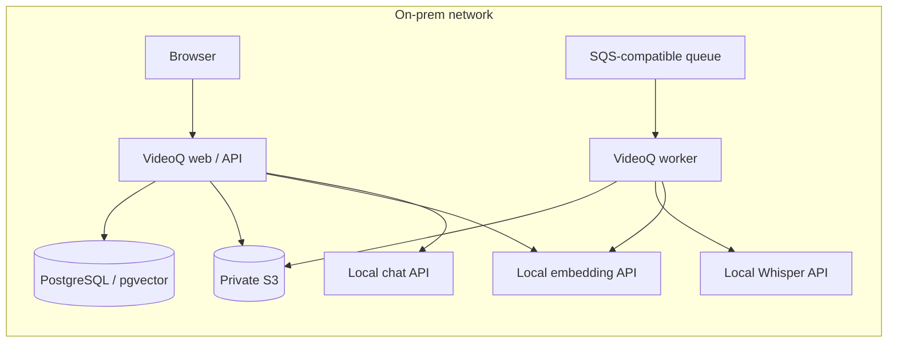

# Local inference for VideoQ

This optional chart installs selectable private LLM / embedding servers and
whisper.cpp (CPU) / vLLM (NVIDIA) speech services. llama.cpp is the CPU default; vLLM is the NVIDIA GPU
option. Install it separately from the application chart so
model caches, GPU scheduling and application upgrades have separate lifecycles.
The application chart's default still uses hosted OpenAI; explicitly apply its
`examples/local-ai-llamacpp.yaml` or `examples/local-ai-vllm.yaml` overlay to select these services.

Mac development runs whisper.cpp natively with Metal, outside this Linux
Kubernetes chart. Both speech engines use the application's `local` backend;
see the [Mac setup and common API contract](../../docs/guides/local-inference.md#mac-development-with-whispercpp).

## Placement and capabilities



CPU defaults use Qwen3-4B Q4_K_M chat, gte-Qwen2-1.5B Q4_K_M embeddings
(native 1536 dimensions) and
whisper.cpp with multilingual quantized `ggml-small-q5_1.bin`. These are starting points for a small acceptance
test. Measure production model quality, throughput, RAM and GPU VRAM with the
site's Japanese videos. The CPU overlay disables visual inspection because its
chat model accepts text only. Transcription, subtitle search, cited Q&A and
timestamp playback remain available. To enable visual inspection, provision a
local vision model supporting images, tool calls and strict JSON Schema,
validate it, and change both charts' chat model plus `config.videoVisualEnabled`.

The site provides PostgreSQL/pgvector, S3 and a persistent SQS-compatible queue
as described in the application chart. No Cloudflare, Modal or OpenAI account
is required for this local configuration. Initial image/model downloads use the
internet. During processing, video, audio, prompts and embeddings stay on the
configured site services.

## Choose an inference engine

| Recipe | Inference values | Application values | Model placement |
|---|---|---|---|
| llama.cpp CPU | defaults or `examples/llamacpp-cpu.yaml` | `charts/videoq/examples/local-ai-llamacpp.yaml` | Separate CPU chat and embedding Pods; Whisper CPU |
| vLLM NVIDIA | `examples/vllm-nvidia.yaml` | `charts/videoq/examples/local-ai-vllm.yaml` | Three GPUs, one each for chat, embedding and Whisper |

The application connects to OpenAI-compatible Chat Completions and embeddings.
Private llama.cpp and vLLM servers use the same protocol as hosted OpenAI.
`EMBEDDING_BASE_URL` selects the embedding endpoint. `ai.embeddingBaseUrl` / `EMBEDDING_BASE_URL` is independent of
`ai.openaiBaseUrl` / `OPENAI_BASE_URL`. An empty embedding URL uses the configured
chat base URL. Optional `EMBEDDING_API_KEY` in the runtime Secret
selects a separate embedding credential; otherwise `OPENAI_API_KEY` is reused.
For the private unauthenticated recipes, use `local-inference` placeholders.
Authentication for existing protected inference services is configured by the
site; these recipe services rely on private ClusterIP and NetworkPolicy.

The same app configuration can point to separately operated compatible servers,
including different chat and embedding runtimes. This chart's `backend` selects
one runtime for both model Pods. Model templates, tool parsers and JSON Schema
behavior must pass the common acceptance suite; API compatibility alone does not
establish VideoQ compatibility. The tested Qwen3/llama.cpp recipe requires
`separateToolSchema=true`. The vLLM recipe starts with
native tools plus schema enforcement and requires GPU acceptance.

The llama.cpp recipe uses pinned Qwen3-4B Q4_K_M chat weights and a pinned
`second-state/gte-Qwen2-1.5B-instruct-GGUF` Q4_K_M embedding conversion. Review the
conversion publisher and SHA256 before site acceptance. That embedding model
natively returns 1536 dimensions. The pinned llama.cpp server does not reduce
Qwen3-Embedding-4B's 2560 dimensions through the request's `dimensions` field;
VideoQ rejects that mismatch, without truncation or padding. vLLM uses Qwen3-4B
and Qwen3-Embedding-4B safetensors, explicitly permitting the latter's trained
Matryoshka output at 1536 dimensions. See [llama.cpp server](https://github.com/ggml-org/llama.cpp/blob/master/tools/server/README.md)
and [vLLM embedding configuration](https://docs.vllm.ai/en/latest/models/pooling_models/embed/#matryoshka-embeddings).

**Rebuild all scene embeddings before searching when changing embedding weights,
quantization, pooling or preprocessing**, even if both configurations return
1536 dimensions. Each profile uses a distinct embedding model alias. API and
worker must receive the same alias and endpoint. When replacing weights, change
both `servers.embedding.servedModel` and `ai.embeddingModel` rather than reusing
an old alias. The existing database does not automatically migrate vector spaces.

## Install llama.cpp or vLLM

First build the Whisper image as below, including the new `provision.py` helper,
and record its private registry digest in `/secure/inference-site.yaml`. Chat and
embedding init containers reuse that image's locked Hugging Face downloader.
GGUF downloads use exact revisions and SHA256; safetensors snapshots use exact
revisions and exclude pickle weights and Python code. Serving Pods mount weights
read-only and run offline. Cached complete models skip network downloads.

Choose one inference/application pair from the table, for example:

```sh
helm upgrade --install inference charts/videoq-inference --namespace videoq --create-namespace \
  -f charts/videoq-inference/examples/llamacpp-cpu.yaml \
  -f /secure/inference-site.yaml --wait --timeout 30m
helm upgrade --install videoq charts/videoq --namespace videoq \
  -f /secure/site.yaml -f /secure/verified-images.json \
  -f charts/videoq/examples/local-ai-llamacpp.yaml --wait --timeout 15m
```

For vLLM replace both profile filenames with `vllm-nvidia.yaml` and
`local-ai-vllm.yaml`. Install the NVIDIA device plugin and review GPU VRAM first.
The profile reserves **three allocatable GPUs** without sharing: chat, embedding and Whisper. Resource limits are starting values, not measured production sizing.
vLLM GPU inference and driver compatibility require actual site acceptance;
the CPU llama.cpp test does not validate them. Before deploying vLLM, scan the
pinned image on the target architecture, including unfixed HIGH/CRITICAL findings:

```sh
trivy image --scanners vuln --severity HIGH,CRITICAL --ignore-unfixed=false --exit-code 1 \
  vllm/vllm-openai@sha256:befccf0e7e4089aa23926bb6f887a85c0d46c2a99e6de5c5ffdf5cb7957c5b34
```

These profiles serve `videoq-inference-chat:8000`,
`videoq-inference-embedding:8000` and `videoq-inference-whisper:8080`.
Use `downloadModels=false` and `networkPolicy.denyEgress=true` after provisioning,
retaining the selected engine profile on every Helm upgrade. Changing `backend`
replaces Deployments; it does not convert PVC contents. Back up old caches and
adopt existing compatible claims explicitly. PVCs use a keep policy.

## Build the private Whisper image

The CPU image supports amd64 and arm64. Build for the Kubernetes nodes, push it
into a private registry, then record its immutable digest. Chat and embedding
init containers also use its locked `provision.py` downloader.

```sh
docker build --platform linux/amd64 \
  -t registry.intranet/videoq-whisper:0.2.0-cpu apps/inference/whisper
docker push registry.intranet/videoq-whisper:0.2.0-cpu
docker buildx imagetools inspect registry.intranet/videoq-whisper:0.2.0-cpu
```

This image is built by the site and is not in the existing signed three-image
GHCR release. Keep an operator-owned values file outside the repository:

```yaml
requireImageDigests: true
whisper:
  image:
    repository: registry.intranet/videoq-whisper
    digest: sha256:REPLACE_WITH_REVIEWED_DIGEST
networkPolicy:
  clientNamespace: videoq
  clientRelease: videoq
```

Use that file with the selected inference/application pair above. The overlay
assumes namespace `videoq`; update the service URLs if changing namespace,
service names or cluster DNS suffix. Match `networkPolicy.clientRelease` to the
application Helm release. Set `OPENAI_API_KEY=local-inference` in its Secret
(and optionally `EMBEDDING_API_KEY`); keep the other runtime credentials from the
application guide. Secret environment variables can override ConfigMap endpoints.

## Restrict processing to the site

Whisper always loads local files, sets `HF_HUB_OFFLINE=1`, and mounts runtime
weights read-only. Its API accepts only `whisper-local` and exposes no model
management. Failures stay local; there is no automatic hosted fallback.

The llama.cpp app overlay sets `ai.reasoningEffort: none` and
`ai.separateToolSchema: true`. The latter separates tool decisions from the
final-answer grammar. When
no more tools are requested, the adapter makes a native JSON Schema call from
the original messages and retrieved evidence. An intermediate draft is discarded
and never streamed or used as conversion input. This adds one final model call;
hosted defaults keep their existing flow. Acceptance includes the production
streaming RAG agent with real inference and fixed retrieval evidence.

CPU inference can take several minutes per agent answer. The local overlay sets
both request deadlines to 600000 ms (ten minutes); set the site's ingress and
client timeouts accordingly. The default hosted deadlines remain unchanged.
GPU deployments can reduce these values after measuring their latency.

The application overlay creates an egress NetworkPolicy allowing its own
namespace and cluster DNS. Add infrastructure namespaces or exact intranet CIDRs
when DB, S3, queues or inference run elsewhere:

```yaml
networkPolicy:
  localEgressOnly: true
  allowedNamespaces: [videoq-data]
  allowedCIDRs: [10.40.20.0/24]
```

The CNI must enforce NetworkPolicy. Policies are additive: remove any other
policy that permits broader egress. Verify from an application Pod that site
services work and public HTTPS is blocked. Add the node-local DNS IP explicitly
if the cluster uses NodeLocal DNS. See
[Kubernetes NetworkPolicy](https://kubernetes.io/docs/concepts/services-networking/network-policies/).
After provisioning, remove downloaders and deny inference egress:

```sh
helm upgrade inference charts/videoq-inference --namespace videoq \
  -f /secure/inference-site.yaml --set downloadModels=false \
  --set networkPolicy.denyEgress=true --wait --timeout 15m
```

Persist these settings in the operator values for future upgrades. Missing
weights fail startup or keep inference Pods unready. Nodes can still pull container images before Pod
startup. The on-prem application edition disables external mail, Google OAuth, Stripe
and YouTube/SearchAPI. This recipe handles uploaded videos and administrator-issued
local accounts; it does not change an explicitly selected inference endpoint.

## NVIDIA Whisper engine

The complete `vllm-nvidia.yaml` profile selects vLLM for speech as well as chat
and embeddings. To add only a speech GPU to a CPU chat/embedding installation,
apply `examples/whisper-nvidia.yaml` and set the application's
`ai.whisperChunkSeconds: 300`. Each model has its own process and dedicated GPU.

Build the audio-capable NVIDIA engine from its separate Dockerfile, scan the
result, push it privately and record its digest alongside the gateway digest:

```sh
docker build --platform linux/amd64 -f apps/inference/whisper/Dockerfile.vllm \
  -t registry.intranet/videoq-whisper-vllm:0.2.0 apps/inference/whisper
trivy image --scanners vuln --severity HIGH,CRITICAL --ignore-unfixed=false --exit-code 1 \
  registry.intranet/videoq-whisper-vllm:0.2.0
docker push registry.intranet/videoq-whisper-vllm:0.2.0
```

```yaml
whisper:
  vllmImage:
    repository: registry.intranet/videoq-whisper-vllm
    digest: sha256:REPLACE_WITH_REVIEWED_DIGEST
```

The pinned vLLM 0.32.0 base needs its `vllm[audio]` extras. The profile provisions
`openai/whisper-large-v3-turbo` at an immutable revision before serving; runtime
uses that local directory. Initial L4 validation used 70% GPU-memory reservation
and eight active sequences. This is not a measured minimum VRAM requirement.
Validate the site's driver, GPU capacity and recognition quality before rollout.

## Speech preprocessing and batching

Both profiles expose the same private gateway on port 8080 and the app uses
`WHISPER_BACKEND=local`, `whisper-local`, `verbose_json`, and segment timestamps.
The engine listens only on loopback port 8081, including its model-management
routes. Only the gateway has a Service. It normalizes audio levels, uses bundled
Silero ONNX VAD, keeps speech spans within 30 seconds, and restores original
source offsets after recognition. Silent input returns no captions. Text without
real timestamps is rejected rather than converted into a fabricated subtitle.
Requests cannot change weights, command arguments, or inference URLs.

`whisper.upstreamParallelism` is 1 for CPU and 4 for NVIDIA.
`whisper.maxConcurrentRequests` bounds uploads and active video requests (CPU 1,
NVIDIA 2); excess traffic receives retryable 503 responses. NVIDIA's
`whisper.maxSequences: 8` configures vLLM's dynamic batching across those speech
requests. It does not wait for eight videos to arrive. The previous faster-whisper
batch-size/device/compute-type fields are removed and rejected by the schema.

The CPU application profile uses 60-second durable checkpoints; NVIDIA and cloud
use 300 seconds. `ai.whisperChunkSeconds` / `WHISPER_CHUNK_SECONDS` accepts 30–300
seconds. Short CPU checkpoints keep individual calls within the worker's
120-second inference deadline without extending queue leases. Completed results
are reused after retries and their offsets remain relative to the source video.
The serial on-prem poller defaults to one message at a time. Measure service
capacity before increasing worker replicas or admission limits.

CPU's quantized multilingual small model is a small acceptance baseline, not a promise of
Japanese recognition accuracy. Larger checkpoints need more CPU/RAM and may need
shorter worker intervals. Review weights, checksums, source coverage, silence,
Japanese accuracy and throughput with representative site recordings.

## Configuration contract

Install using the selected engine profile and a current operator values file.
Only the documented fields are accepted; unknown chart options fail validation.
Chat and embedding endpoints/models must match the application profile. There
is no provider selector: the embeddings protocol is OpenAI-compatible.

## Acceptance checks

From a reviewed checkout with npm dependencies, uv and FFmpeg installed,
port-forward the private services in separate terminals:

```sh
kubectl -n videoq port-forward service/videoq-inference-chat 11436:8000
kubectl -n videoq port-forward service/videoq-inference-embedding 11437:8000
kubectl -n videoq port-forward service/videoq-inference-whisper 18085:8080
```

Never expose these ports publicly. Use a short, nonsensitive speech video.
 Set the
embedding alias for the chosen recipe (`qwen3-embedding-4b-5cf2132a` for vLLM).
For vLLM start with `LOCAL_AI_TEST_SEPARATE_TOOL_SCHEMA=false`, matching its app profile:

```sh
LOCAL_AI_TEST_CHAT_BASE_URL=http://127.0.0.1:11436/v1 \
LOCAL_AI_TEST_EMBEDDING_BASE_URL=http://127.0.0.1:11437/v1 \
LOCAL_AI_TEST_MODEL=videoq-chat \
LOCAL_AI_TEST_SEPARATE_TOOL_SCHEMA=true \
LOCAL_AI_TEST_EMBEDDING_MODEL=gte-qwen2-1.5b-q4km-124fbdad \
LOCAL_AI_TEST_WORKER_PYTHON="$PWD/apps/worker/.venv/bin/python" \
  npm run test:unit --workspace @videoq/api -- test/local-inference.integration.test.ts
WHISPER_BACKEND=local WHISPER_LOCAL_URL=http://127.0.0.1:18085/v1 \
EMBEDDING_BASE_URL=http://127.0.0.1:11437/v1 \
EMBEDDING_MODEL=gte-qwen2-1.5b-q4km-124fbdad EMBEDDING_API_KEY=local-inference \
  uv run --project apps/worker --locked python \
  apps/worker/scripts/check_local_inference.py /secure/test.mp4 --seconds 30
```

The same suite checks native structured answers, tools, streaming, cited RAG and
1536-dimensional embeddings. With `LOCAL_AI_TEST_WORKER_PYTHON` it also compares
TypeScript query embeddings to a real Python indexing batch. The RAG test uses
fixed retrieval evidence, not a live database or browser. Optional protected
services use `LOCAL_AI_TEST_API_KEY` / `LOCAL_AI_TEST_EMBEDDING_API_KEY`.
`LOCAL_AI_TEST_SEPARATE_TOOL_SCHEMA=true` is available when a particular
model/server needs the two-call workaround; record that choice in app values.
Finish with upload → transcription → indexing → cited Q&A → timestamp playback
through the UI with public egress blocked. Record model/image digests and site
quality/throughput results. The worker check does not write to the DB.
Uninstall inference separately from the app; PVCs are retained. Adopt compatible
claims through `persistence.existingClaim` on reinstall.
