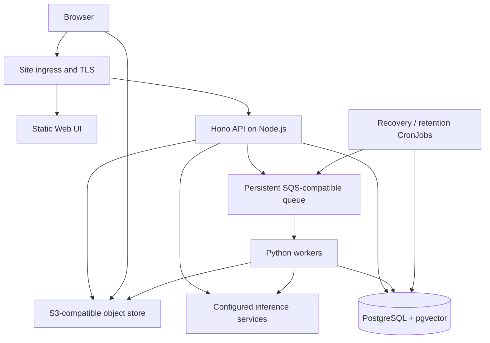

# Run VideoQ on-premises

VideoQ can run its Web UI, Node.js API and Python workers on an existing
Kubernetes cluster. For an initial small installation, a single-node K3s cluster
is an option. The application is distributed through the repository's
[Helm chart](https://github.com/videoq-jp/videoq/tree/main/charts/videoq),
which contains installation, upgrade and rollback instructions, example values,
and the external infrastructure requirements.

## Runtime layout

The chart manages application workloads. PostgreSQL, S3 storage, queue durability,
inference services, cluster administration, DNS and TLS are managed by the site.
Configure their addresses instead of installing duplicate infrastructure in the
application release. A GPU inference server can run in the same cluster or on a
separate machine; API and video workers call its endpoint.

For a concrete CPU or NVIDIA GPU deployment of local chat, embeddings and
Whisper, see [local inference](local-inference.md). The default application
values use hosted OpenRouter; the local overlay is an explicit opt-in.

## How it differs from Cloudflare

| Function | Cloud deployment | On-prem deployment |
|---|---|---|
| HTTP and chat | Workers / ChatExecution DO | Hono Node.js server with the same HTTP pipeline |
| Database connections | Hyperdrive | Direct PostgreSQL, with a process-owned pool |
| Shared rate limits | RateLimiter DO | PostgreSQL rows with transactional locking |
| Outbox / abandoned upload recovery | TaskScheduler DO alarms | CronJob reading the same persisted DB state every minute |
| Retention | Workers daily cron | Daily UTC CronJob |
| Media operations | R2 binding and signed URLs | S3 API and signed URLs |
| Video jobs | Lambda SQS trigger | Long-polling Python Deployment |

The Node entrypoint does not load Durable Object classes or run `wrangler dev`.
It enforces production authentication and validates required secrets on startup.
The two chat transports keep their normal authentication, permissions, quota
checks and streaming behavior. No inference service is called by the built-in
HTTP smoke test.

## First installation

1. Prepare PostgreSQL 17 with pgvector, a private S3 bucket and a persistent
   SQS-compatible queue with dead-letter delivery. Configure bucket CORS and
   ensure browsers can reach the S3 public endpoint.
2. Build the API, web and on-prem worker images from the chart README and load
   them into a registry reachable by the cluster.
3. Create the namespace and operator-owned Secret described in the chart README.
   API and worker must share the same user-secret encryption key.
4. Copy `charts/videoq/examples/site.yaml` outside the repository, replace all
   example values, and run Helm lint/template before installation.
5. Install the chart. Its pre-install migration Job must complete before the
   application workloads are created.
6. Confirm `/ready`, create the first administrator with `node dist/provision-user.mjs --admin --username site_admin --email admin@example.com` inside the API Pod, and privately open the returned single-use setup link. Then upload a short video and test Q&A and timestamp playback.

The repository does not publish images at the `registry.example.edu` addresses;
these are placeholders for site-built images. For a disconnected network,
transfer all images and the packaged chart ahead of time. Point chat, embeddings
and transcription at validated local services. The on-prem edition disables Stripe,
Google sign-in, YouTube/SearchAPI and Mailgun.

The chat adapter requires a nonempty `OPENAI_API_KEY` for local OpenAI-compatible
servers too. Use a placeholder such as `local-inference` if that server has no
authentication. Embeddings reuse it unless `EMBEDDING_API_KEY` is set.

For internet-connected sites, see [signed releases and updates](on-premises-releases.md)
for artifact verification, automatic staging rehearsals and promotion.

## Operations

The API and worker scale independently. Size the database connection budget for
all API replicas, vector-search connections, workers and maintenance Jobs.
Changing the embedding model requires a planned reindex of existing data;
dimensions alone do not make models interchangeable.

Set `api.trustedProxyHops` only after configuring the site's trusted ingress
chain. Without it, IP rate limiting uses the TCP peer. Disable SSE buffering and
configure an adequate response timeout on the ingress controller.

The worker stops taking new messages on SIGTERM and acknowledges completed work
before exiting. Its default 840-second processing deadline stays below the
900-second execution lease. Unfinished work is retried through the existing
persisted checkpoints. Monitor CronJob failures, queue age and dead letters.

Keep database, object data and encryption-key backups. A Helm rollback restores
application manifests; SQL migration rollback and data restoration need their
own tested procedure. Pre-upgrade migrations must remain compatible with the
old application while its Pods are still running. See the chart README for
breaking migrations, Secret rotation and recovery details.

## Application pages and account provisioning

The on-prem web image and Node API use the on-prem edition by default. It omits
SaaS billing, the LP/pricing/commercial legal pages and public registration.
Signed-out users enter at login. Administrators add users and issue short-lived,
single-use setup/recovery links; no external mail service is needed. Course
invitation links can also be shared privately with existing local accounts.
New users have administrator-managed operational quotas instead of SaaS free
plan caps. Existing user quotas are preserved until an administrator changes them.
See the [edition and bootstrap instructions](https://github.com/videoq-jp/videoq/blob/main/charts/videoq/README.md#on-prem-application-edition).
Core video/course/search/chat, API keys/MCP and intranet sharing remain available.
